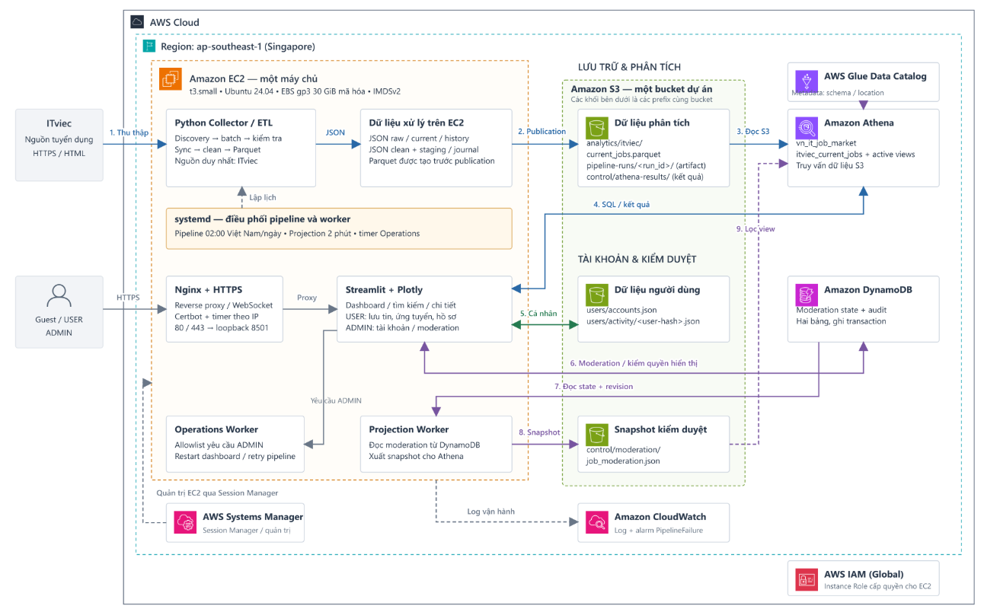

## VIETNAM IT JOB MARKET

### IT recruitment data collection, processing and analytics on AWS

### 1. Executive summary

This proposal presents the Vietnam IT Job Market solution and the actual deployment results of the project.

Vietnam IT Job Market collects ITviec listings with Python, processes JSON on one EC2 and publishes analytical Parquet to S3. Glue Data Catalog provides metadata for Athena. Streamlit and Plotly deliver analytics through Nginx HTTPS. The deployment region is ap-southeast-1. Personal data is stored in S3; moderation state and audit are stored in DynamoDB.

### 2. Problem statement

Individual listings are difficult to aggregate manually and repeated collection requires deduplication, validation and change tracking. Users need saved jobs and self-managed application tracking; administrators need reversible moderation and traceable operations. The dataset covers accessible ITviec listings, not the entire Vietnamese IT labour market.

### 3. Solution architecture

The data flow is ITviec → Python collection and processing on EC2 → Parquet on Amazon S3 → Amazon Athena → Streamlit Dashboard. AWS Glue Data Catalog supplies the table schema and data location to Athena. Run artifacts remain separate from the canonical analytics prefix. Accounts and personal activity use S3 objects. DynamoDB moderation transactions write state and audit; a Projection Worker publishes an S3 snapshot for Athena filtering. The application also checks DynamoDB.

One EC2 simplifies the project deployment but is a shared failure point. Glue is used as Data Catalog, while Python on EC2 performs ETL.

### 4. Technical implementation

Discovery and batches are validated before ETL; collectors process up to 25 URLs per batch by default. Current records use job_id, retain first_seen and update last_seen. Missing listings alone do not imply expiry. Cleaning and Parquet export are checked for schema and row-count consistency. ETag conditions, staging, journals and backups support controlled publication.

Guest users explore public analytics. USER adds saved jobs, application tracking, profile and password management. ADMIN adds six administration pages, for ten pages overall. The dashboard has four overall and four weekly KPIs plus seven chart groups. Weekly comparisons use retained listings by posting date; application tracking does not submit CVs.

Deployment records describe t3.small Ubuntu 24.04 with encrypted 30 GiB gp3 storage. Streamlit runs as vnjob on 127.0.0.1:8501; Nginx exposes HTTPS and forwards WebSocket traffic. Runtime uses an IAM Role and IMDSv2. Passwords use salted PBKDF2-HMAC-SHA256 with 600,000 iterations. Role, account status and session checks protect actions.

systemd schedules the pipeline daily at 02:00 Vietnam time. Projection runs every two minutes. The Operations Worker validates allowlisted administrator recovery requests. Certbot and an IP-aware helper maintain HTTPS; CloudWatch records logs and pipeline failures. Email notifications are not established by the presence of a Console alarm.

### 5. Implementation roadmap

| Phase | Deliverable |
| --- | --- |
| Design | Source scope, schema, roles and architecture |
| Collection and ETL | Validated artifacts, current/history, cleaned JSON and Parquet |
| Analytics | Canonical S3 data, Glue metadata and Athena views |
| Application | Dashboard, personal features and moderation |
| Deployment | EC2 services, HTTPS, timers, workers and monitoring |
| Acceptance | Dated tests, screenshots, runbook and Workshop |

### 6. Budget basis

Estimated monthly costs for the system in Singapore (ap-southeast-1), with the server running continuously:

| Component | Estimated monthly cost (USD) |
| --- | ---: |
| EC2 t3.small Linux | 19.27 |
| EBS gp3, 30 GiB | 2.88 |
| One public IPv4 address | 3.65 |
| **Baseline total** | **25.80** |

**Planned budget: USD 35/month**, including the USD 25.80 baseline and a USD 9.20 allowance for S3, Glue Data Catalog, Athena, DynamoDB (including point-in-time recovery), CloudWatch and data transfer. These costs depend on storage, requests, scanned data and log volume. The allowance is a planning reserve, not measured spending.

This estimate excludes tax and additional T3 CPU credit charges, if incurred, and is calculated before credits or discounts. It is not an actual bill. EC2 and EBS rates are recorded in the project's deployment documentation; IPv4 pricing follows the [Amazon VPC pricing page](https://aws.amazon.com/vpc/pricing/).

### 7. Risk assessment

Source changes and blocking can interrupt collection; validation and bounded retry do not guarantee coverage. Schema or duplicate files can distort analysis. Publication journals and conditional writes support recovery, while moderation projection remains eventually consistent. A single EC2, changing public IPs and certificate dependencies can interrupt access. Runtime roles, private configuration and server-side session checks reduce access risks. Backup verification is separate from production restoration across all data stores.

### 8. Deployment results

#### 8.1. Source-code tests

On 11 November 2026, the development machine completed **140 unit tests** with an **OK** result. Registration, moderation and Vietnamese UI smoke tests also reported successful checks.

#### 8.2. Deployed system checks

Screenshots and logs dated 11 November 2026 record:

| Component | Result |
| --- | --- |
| Pipeline | 25/25 batches, 624 collected listings, SUCCEEDED and published=true |
| Processed data | 1,072 current/clean records; Parquet with 1,072 rows and 24 columns |
| S3 | Published Parquet metadata identifies the processing run |
| Dashboard | 654 active jobs, 321 companies, 131 listings with disclosed salaries and 328 skills without filters |
| Web access | HTTP redirects to HTTPS, health returns ok and WebSocket returns 101 |
| Automation | Pipeline timer enabled for 02:00 Vietnam time; supporting service status and logs recorded |

The collection run returned **624 listings**; the synchronized current dataset contained **1,072 records**; the dashboard showed **654 active jobs** at the time of inspection. The run recorded snapshot_complete=false and is not a full snapshot.
