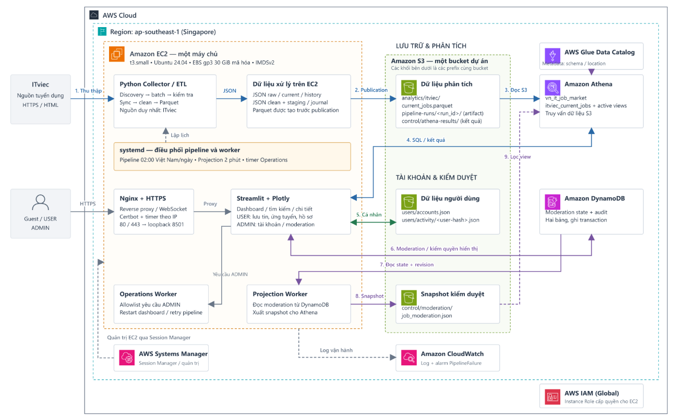

Vietnam IT Job Market collects IT job listings from **ITviec**, processes them with Python, stores Parquet on S3 and analyzes the data using Athena/Streamlit. This workshop explains component setup and AWS operation.

### System architecture

One EC2 instance runs the collector, ETL, dashboard, Nginx and workers. Raw/current/history/clean JSON is processed on EC2; analytical Parquet and personal data are stored on S3. Glue Data Catalog provides metadata. DynamoDB stores moderation/audit data, and the Projection Worker exports snapshots for Athena filtering. systemd manages schedules, while CloudWatch receives logs and failure alarms.

### Objectives

- Set up data resources, metadata, permissions and application configuration.
- Package source code, deploy EC2 and initialize runtime data.
- Run collection, ETL and publication, then connect the dashboard.
- Set up USER/ADMIN features, HTTPS, timers, workers and monitoring.
- Test the system and compare results with actual screenshots and logs.

### Deployment scope

The system is deployed in account **381924757765**, in **Singapore (ap-southeast-1)**. S3, Glue Data Catalog and DynamoDB are prepared before EC2 deployment. One EC2 instance runs the pipeline, dashboard and workers; Nginx provides HTTPS web access.

The data reflects accessible ITviec listings rather than the entire market. Users update application tracking themselves; the system does not submit CVs automatically.

### Deployment sequence

Preparation → S3 → Catalog/Athena → DynamoDB → EC2 → collection → ETL/publication → dashboard → accounts/administration → HTTPS → schedules/workers → CloudWatch → acceptance/backup.

---

[Contents](../) · [4.2 →](../5.2-Prerequisites/)
