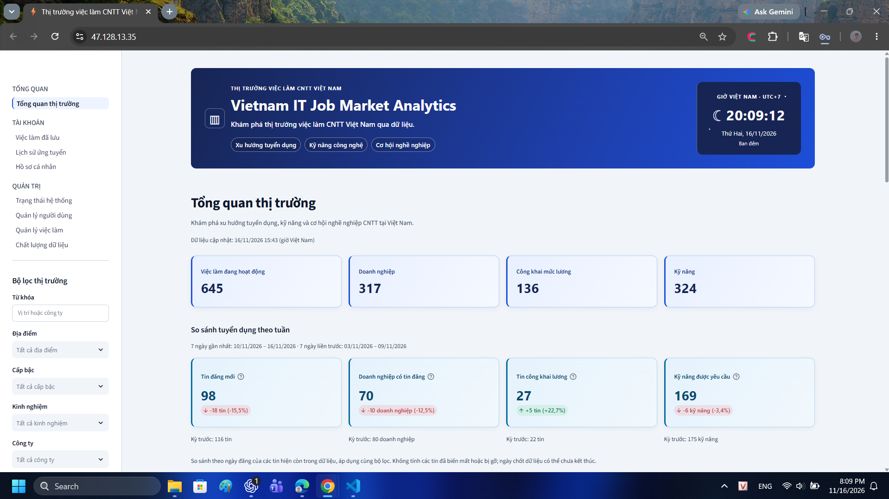

The application distinguishes **Guest**, **User** and **Administrator** roles. Guests can view the market overview; users have personal features; administrators can manage users, moderate jobs and monitor the system. Accounts and personal activity are stored on Amazon S3.

---

[← 4.10. Accounts and administration](../) · [Workshop contents](../../) · [Next step →](../5.10.2-step2/)
