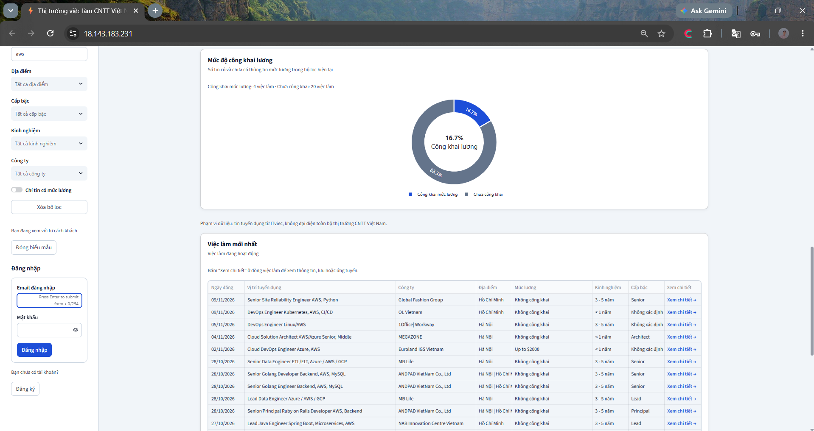
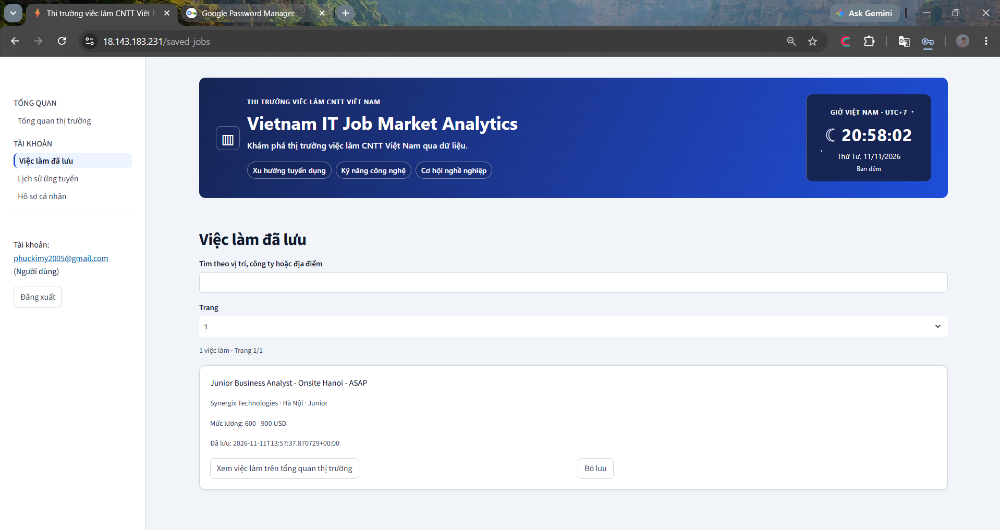
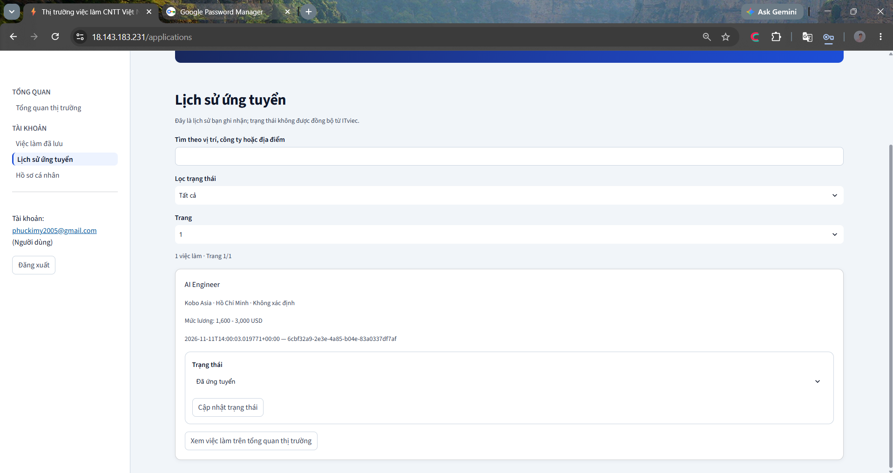

The application supports registration and login using email and password. After signing in, users can save jobs, track applications and manage their profiles.

**Saved jobs** collects listings to revisit and supports searching, opening and removing saved listings.

**Application history** helps users track their job search. Users update the status themselves; it is not synchronized automatically from ITviec.

---

[← 4.10. Accounts and administration](../) · [Workshop contents](../../) · [Previous step](../5.10.1-step1/) · [Next step →](../5.10.3-step3/)
