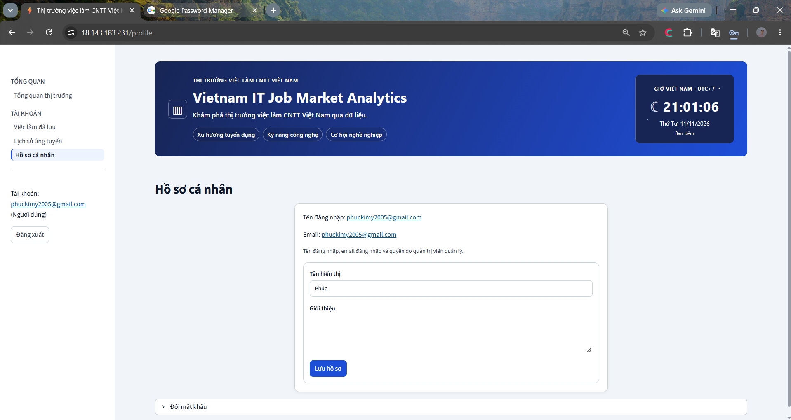
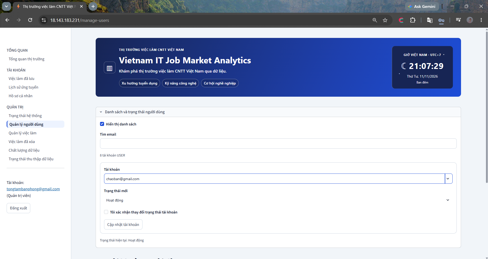
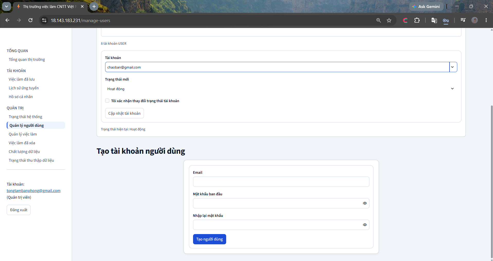

The **Personal profile** page allows users to update their display name and introduction and change their password.

The **User management** page allows ADMIN to find accounts and manage their active status. ADMIN can also create USER accounts using email and an initial password.

---

[← 4.10. Accounts and administration](../) · [Workshop contents](../../) · [Previous step](../5.10.2-step2/)
