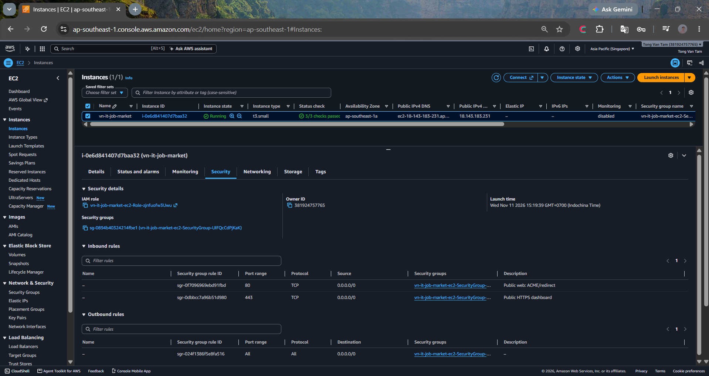
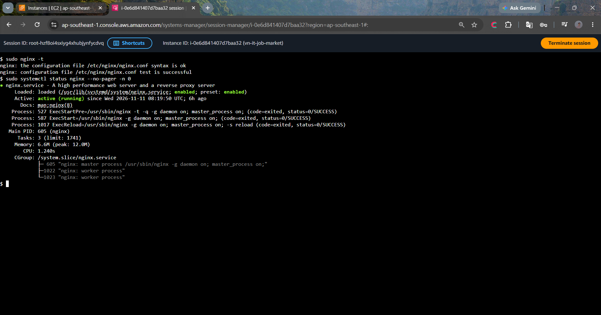

### Role in the system

Nginx receives web traffic and forwards requests to Streamlit running internally at 127.0.0.1:8501. Port 80 handles HTTP and port 443 handles HTTPS; WebSocket configuration maintains the dashboard's interactive connection. The Security Group controls which ports can be accessed externally.

### Configuration used

The **vn-it-job-market-ec2-public** stack manages TCP ingress on ports 80/443 for the project's Security Group. Nginx forwards HTTP/WebSocket traffic to **127.0.0.1:8501**; ports 22/8501 are not publicly exposed in the deployment configuration.


Port **80** supports ACME certificate validation and HTTP redirection; port **443** accepts HTTPS connections to the dashboard. Both ports allow Internet access from **0.0.0.0/0**.



The application configuration uses /etc/nginx/vnjob-proxy.inc, installed from deploy/ec2/proxy.inc, with upstream settings and WebSocket/X-Forwarded-Proto headers. The following HTTPS steps describe the server configuration.


### Check Nginx

The `nginx -t` command validates the configuration; `systemctl status` reports the service state. The output shows a successful configuration check and Nginx **active (running)**, with startup enabled.

```bash
sudo nginx -t
sudo systemctl status nginx --no-pager -n 0
```




---

[← 4.11. Configure Nginx and IP-based HTTPS](../) · [Workshop contents](../../) · [Next step →](../5.11.2-step2/)
