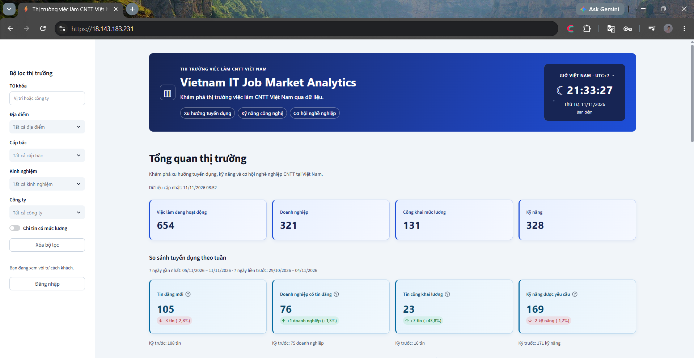
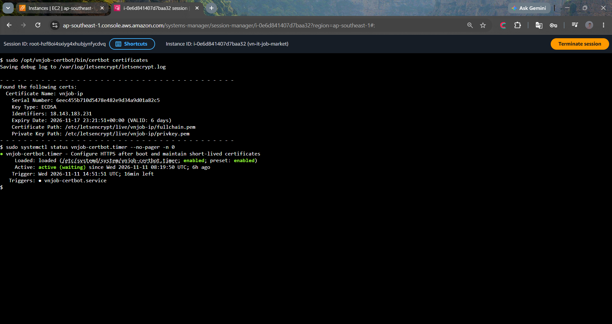

**Run in:** SSM on EC2

### Objectives

Issue an IP certificate and install a timer that handles IP changes.

### Prerequisites

Ingress on ports 80/443 works, Nginx is installed, and the configuration include exists.

### Procedure

Prepare the Certbot runtime using the project's procedure:

~~~bash
sudo python3 -m venv /opt/vnjob-certbot
sudo /opt/vnjob-certbot/bin/pip install "certbot>=5.4,<7"
sudo /opt/vnjob-certbot/bin/certbot --version
sudo install -d -m 0755 /var/www/letsencrypt/.well-known/acme-challenge
~~~

Install the HTTPS configuration tool that detects the EC2 public IP address:

~~~bash
cd /opt/vn-it-job-market
sudo bash deploy/ec2/configure_public_https.sh
sudo nginx -t
sudo /opt/vnjob-certbot/bin/certbot certificates
sudo systemctl list-timers vnjob-certbot.timer --no-pager
~~~

The script requires the Certbot executable, the vnjob site and the existing proxy include. It backs up the configuration, installs /usr/local/sbin/vnjob-auto-https.py and the units, runs reconciliation, then enables the timer. The helper reads IMDSv2, configures ACME HTTP, issues a certificate when the IP changes or fewer than two days remain, validates Nginx, and reloads or rolls back on failure. The timer starts 30 seconds after boot and 30 minutes after each completed execution.

When the public IP changes, the service checks the new address and updates the certificate and Nginx configuration.

### Check the results

Check the certificate issued for the current IP and the automatic HTTPS management timer.

### Access the website over HTTPS

HTTPS encrypts traffic between the browser and website, protecting login information and user activity in transit. The dashboard is accessed at **https://18.143.183.231**, as shown below.



### Installed HTTPS certificate

Certbot manages the **vnjob-ip** certificate for the server's IP address. The output shows an **ECDSA** key and a certificate valid when captured, expiring at **23:21:51 on 17 November 2026 (UTC)**.

```bash
sudo /opt/vnjob-certbot/bin/certbot certificates
sudo systemctl status vnjob-certbot.timer --no-pager -n 0
```

The **vnjob-certbot** timer automatically triggers the HTTPS management service. The output shows it **enabled**, **active (waiting)**, with a next execution scheduled.




---

[← 4.11. Configure Nginx and IP-based HTTPS](../) · [Workshop contents](../../) · [Previous step](../5.11.1-step1/) · [Next step →](../5.11.3-step3/)
