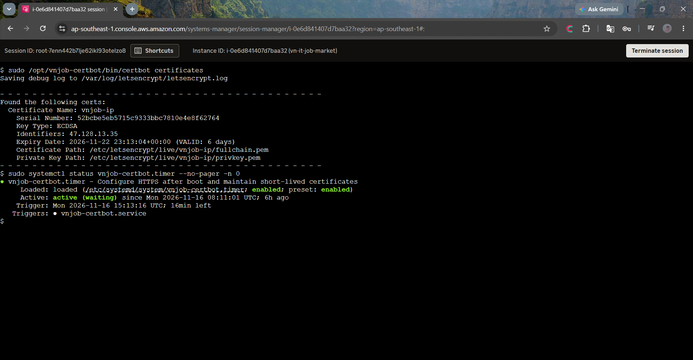
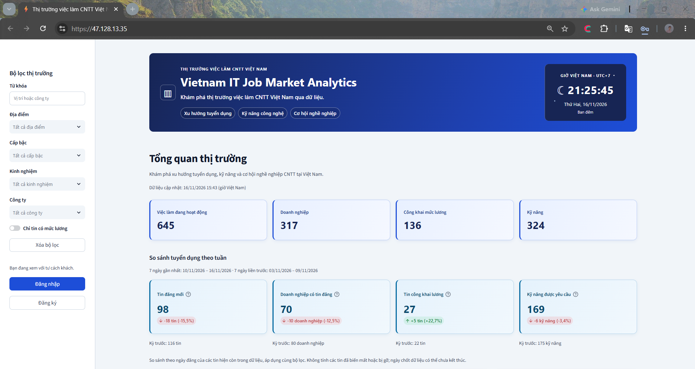

**Thực hiện tại:** SSM trên EC2

### Mục tiêu

Cấp chứng chỉ IP và cài timer theo IP thay đổi.

### Điều kiện đầu vào

Ingress 80/443 hoạt động, Nginx đã cài và include tồn tại.

### Các bước thực hiện

Chuẩn bị runtime Certbot theo quy trình project:

~~~bash
sudo python3 -m venv /opt/vnjob-certbot
sudo /opt/vnjob-certbot/bin/pip install "certbot>=5.4,<7"
sudo /opt/vnjob-certbot/bin/certbot --version
sudo install -d -m 0755 /var/www/letsencrypt/.well-known/acme-challenge
~~~

Cài bộ cấu hình HTTPS tự nhận địa chỉ IP công khai của EC2:

~~~bash
cd /opt/vn-it-job-market
sudo bash deploy/ec2/configure_public_https.sh
sudo nginx -t
sudo /opt/vnjob-certbot/bin/certbot certificates
sudo systemctl status vnjob-certbot.timer --no-pager -n 0
~~~

Script cần Certbot executable, site vnjob và proxy include sẵn có; backup cấu hình, cài /usr/local/sbin/vnjob-auto-https.py và units, chạy reconcile rồi bật timer. Helper đọc IMDSv2, cấu hình ACME HTTP, cấp chứng chỉ khi IP thay đổi hoặc còn dưới hai ngày, kiểm Nginx rồi reload/rollback khi lỗi. Timer boot 30 giây, sau mỗi lượt hoàn tất 30 phút.

Khi IP công khai thay đổi, dịch vụ kiểm tra địa chỉ mới và cập nhật chứng chỉ cùng cấu hình Nginx.

### Kiểm tra kết quả

Chứng chỉ **vnjob-ip** được cấp cho IP **47.128.13.35** và còn hiệu lực tại thời điểm kiểm tra ngày **16/11/2026**. Timer **vnjob-certbot** đã bật và đang chờ lịch chạy để tự động quản lý chứng chỉ HTTPS.

### Truy cập website qua HTTPS

HTTPS mã hóa thông tin đăng nhập và hoạt động của người dùng khi truyền qua mạng. Địa chỉ được xác minh ngày **16/11/2026** là **https://47.128.13.35**. Timer **vnjob-certbot** duy trì chứng chỉ cho IP và cập nhật cấu hình khi địa chỉ thay đổi.

---

[← 4.10. Thiết lập Nginx và HTTPS theo IP](../) · [Mục lục Workshop](../../) · [Bước trước](../5.11.1-step1/) · [Bước tiếp →](../5.11.3-step3/)
