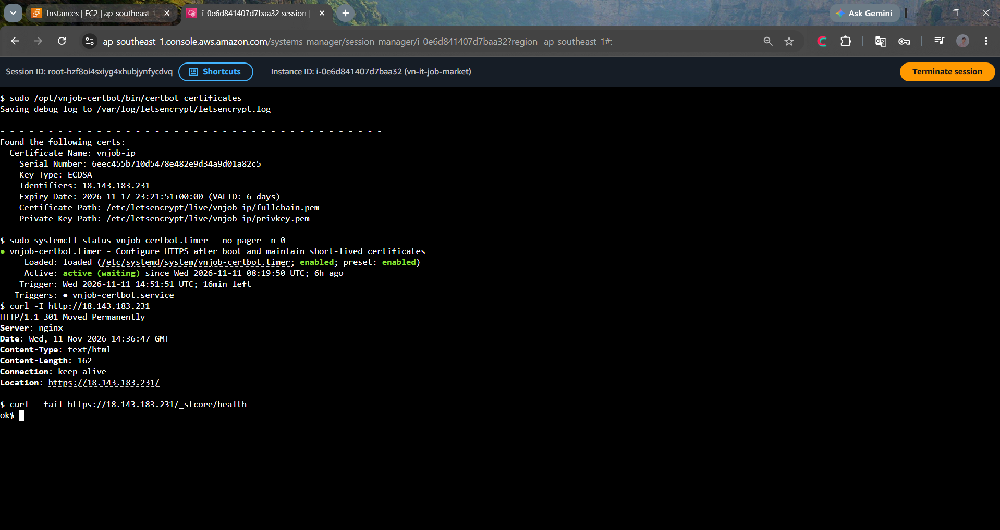
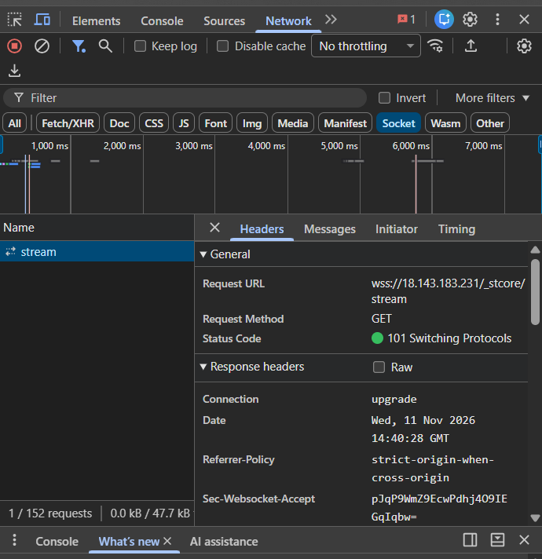

**Run in:** EC2 SSM terminal and browser

### Objectives

Verify the access path after configuration.

### Prerequisites

Use the current IPv4 address from the Console, rather than an old address in previous records.

### Procedure

Check HTTP redirection and the HTTPS response in the SSM terminal. Then open the website in a browser to check Streamlit's interactive connection.

### Check the results

Check HTTP redirection, the HTTPS response and the WebSocket connection in that order.

### Check HTTP redirection and the HTTPS response

Nginx redirects HTTP traffic to HTTPS so users continue over an encrypted connection. The check returns **301 Moved Permanently**, with the header **Location: https://18.143.183.231/**.

```bash
curl -I http://18.143.183.231
curl --fail https://18.143.183.231/_stcore/health
```

The **/_stcore/health** endpoint returns **ok** over HTTPS, confirming that the application responds through Nginx using a TLS connection validated by curl.



### WebSocket connection

Open DevTools (F12) → Network → Socket, reload the page, and select **stream** → **Headers**.

WebSocket maintains the interactive connection between the browser and Streamlit while users operate the dashboard. In DevTools, **wss://18.143.183.231/_stcore/stream** returns **101 Switching Protocols**, confirming a successful WebSocket handshake through Nginx over TLS.




---

[← 4.11. Configure Nginx and IP-based HTTPS](../) · [Workshop contents](../../) · [Previous step](../5.11.2-step2/)
