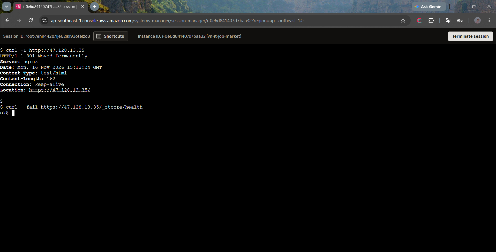
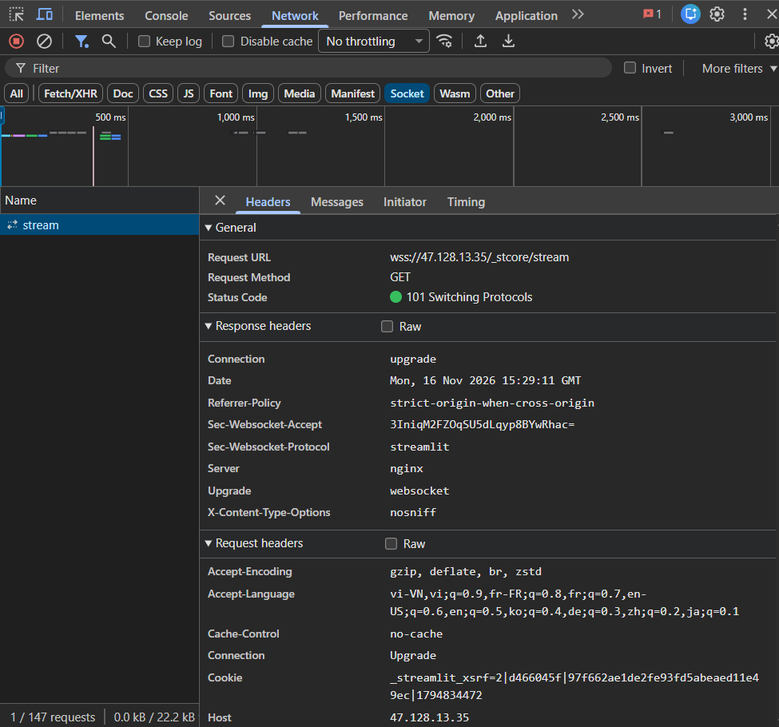

Nginx redirects HTTP traffic to HTTPS to protect data exchanged between the browser and application.

The address verified in the **16 November 2026** deployment was **https://47.128.13.35**. EC2 uses an automatically assigned IP address, which may change after Stop/Start.

~~~bash
curl -I http://47.128.13.35
curl --fail https://47.128.13.35/_stcore/health
~~~

HTTP returns **301 Moved Permanently** and redirects to HTTPS. The HTTPS health endpoint returns **ok**, confirming that the application responds over a secure connection.

### Check WebSocket

WebSocket maintains Streamlit's interactive connection. Open DevTools → Network → Socket, reload the page and select **stream**. In Headers, inspect **wss://47.128.13.35/_stcore/stream**; the connection returns **101 Switching Protocols**.

---

[← 4.10. Configure Nginx and IP-based HTTPS](../) · [Workshop contents](../../) · [Previous step](../5.11.2-step2/)
