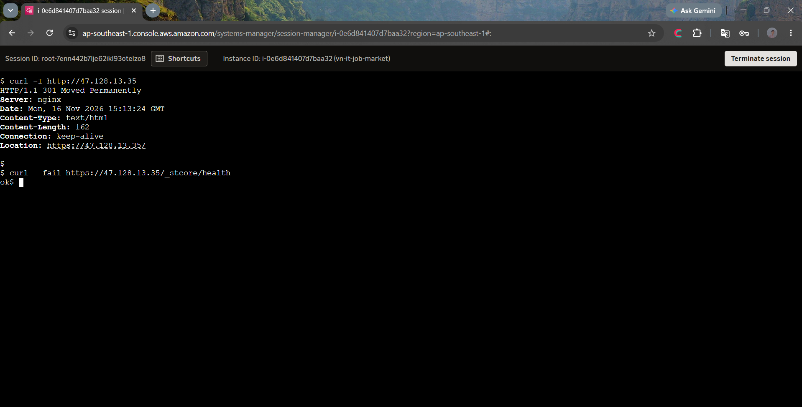
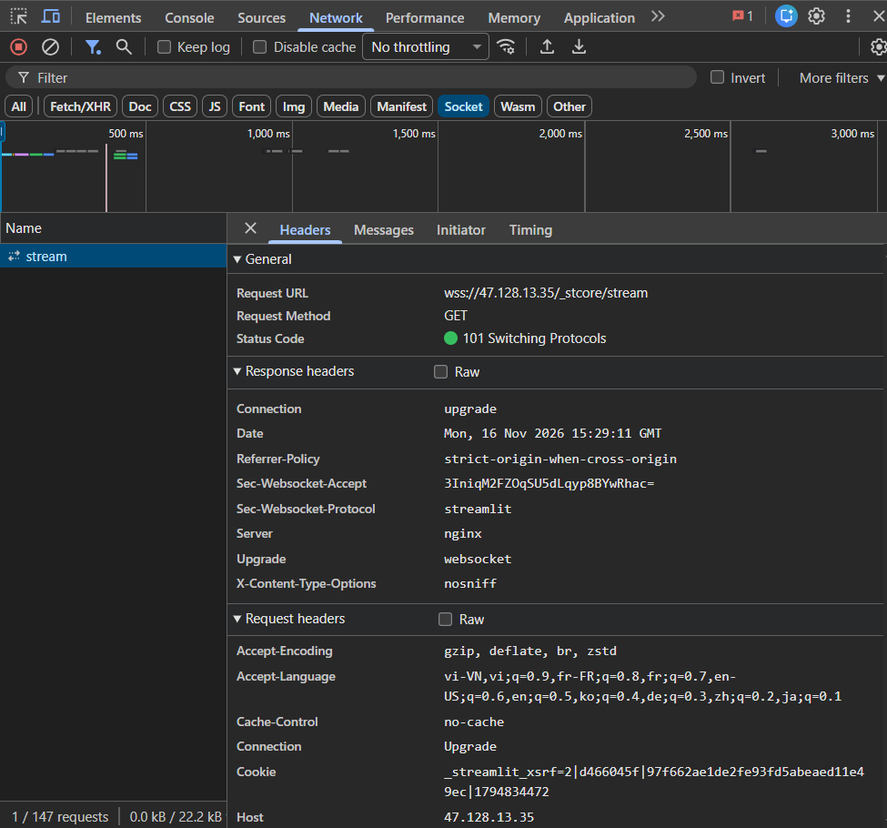

Nginx chuyển truy cập HTTP sang HTTPS để bảo vệ dữ liệu truyền giữa trình duyệt và ứng dụng.

Địa chỉ được xác minh trong đợt triển khai ngày **16/11/2026** là **https://47.128.13.35**. EC2 dùng IP tự cấp nên địa chỉ có thể thay đổi khi Stop/Start.

~~~bash
curl -I http://47.128.13.35
curl --fail https://47.128.13.35/_stcore/health
~~~

HTTP trả về **301 Moved Permanently** và chuyển sang HTTPS. Health endpoint qua HTTPS trả về **ok**, xác nhận ứng dụng phản hồi qua kết nối bảo mật.

### Kiểm tra WebSocket

WebSocket duy trì kết nối tương tác của Streamlit. Mở DevTools → Network → Socket, tải lại trang và chọn **stream**. Trong Headers, kiểm tra kết nối **wss://47.128.13.35/_stcore/stream**; kết nối trả về **101 Switching Protocols**.

---

[← 4.10. Thiết lập Nginx và HTTPS theo IP](../) · [Mục lục Workshop](../../) · [Bước trước](../5.11.2-step2/)
