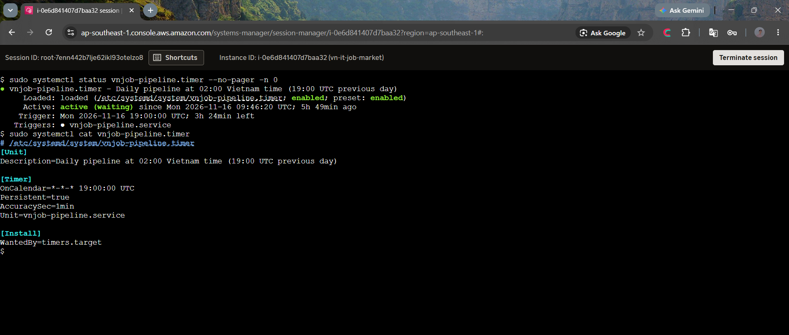

### Daily data update schedule

The **vnjob-pipeline** timer triggers the recruitment data collection and processing pipeline daily, automatically updating data on EC2. **OnCalendar=*-*-* 19:00:00 UTC** corresponds to **02:00 Vietnam time the following day**.

**Persistent=true** allows a missed execution to be triggered after server downtime. **AccuracySec=1min** sets a one-minute scheduling tolerance.

### Check the configuration

```bash
sudo systemctl status vnjob-pipeline.timer --no-pager -n 0
sudo systemctl cat vnjob-pipeline.timer
```

The output shows the timer **enabled**, **active (waiting)**, and scheduled to trigger **vnjob-pipeline.service**.



---

[← 4.11. Schedule the pipeline and Operations Worker](../) · [Workshop contents](../../) · [Next step →](../5.12.2-step2/)
