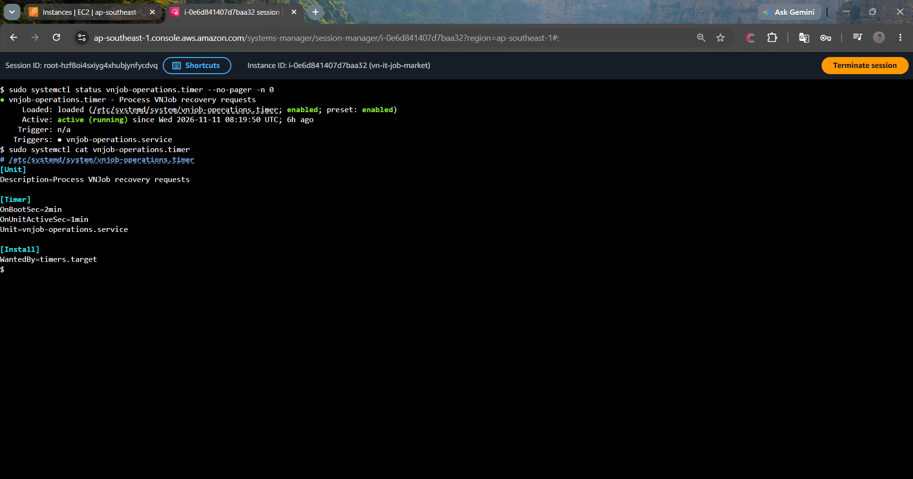
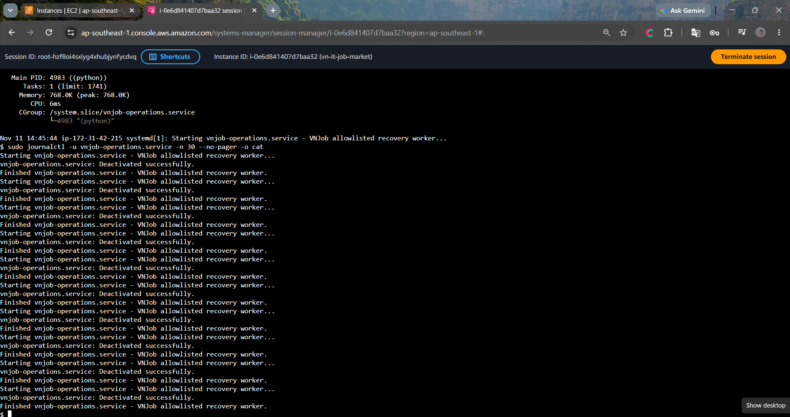

**Run in:** SSM and secrets.toml

### Objectives

Install the recovery backend before enabling ADMIN features.

### Prerequisites

The runtime exists, worker source files are owned by root, and a valid ADMIN account is available.

### Procedure

~~~bash
cd /opt/vn-it-job-market
sudo bash deploy/ec2/install_recovery.sh
systemctl status vnjob-operations.timer --no-pager
sudo journalctl -u vnjob-operations.service -n 80 --no-pager
~~~

The script installs the operations unit/timer and updates/restarts the pipeline timer. Since restarting the timer may trigger a missed execution, choose the setup time after checking the pipeline state.

After checking the worker, set operations_enabled=true in the secrets [auth] section and restart the dashboard. In the environment file, PIPELINE_AUTO_RETRY=true enables limited retries; OPERATIONS_ACCOUNTS_KEY=users/accounts.json must match the actual data location.

Operations Worker checks administrator permissions and handles only operations allowed by the system, such as restarting the dashboard or retrying the pipeline.

### Operations Worker timer status

The **vnjob-operations** timer triggers the operations request service. **OnBootSec=2min** schedules activation two minutes after boot; **OnUnitActiveSec=1min** sets the interval from the previous service activation.

```bash
sudo systemctl status vnjob-operations.timer --no-pager -n 0
sudo systemctl cat vnjob-operations.timer
```

The screenshot shows the timer **enabled**, **active (running)**, and linked to **vnjob-operations.service**.




### Execution log

Operations Worker runs in individual executions to check and process permitted operations requests. The log records service executions ending with **Deactivated successfully** and **Finished**.

```bash
sudo journalctl -u vnjob-operations.service -n 30 --no-pager -o cat
```




---

[← 4.11. Schedule the pipeline and Operations Worker](../) · [Workshop contents](../../) · [Previous step](../5.12.1-step1/) · [Next step →](../5.12.3-step3/)
