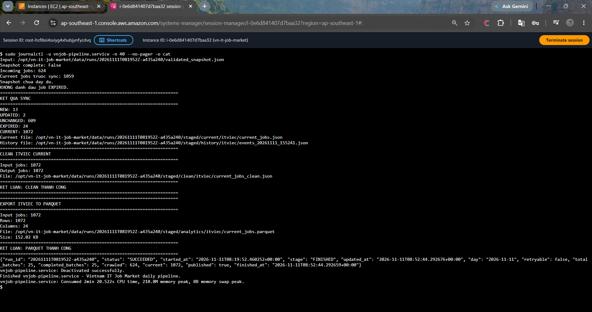

**Run in:** SSM and the System Status page

### Objectives

Interpret the results after scheduled execution or a recovery request.

### Prerequisites

The journal/status.json for the execution being checked is available.

### Procedure

~~~bash
sudo journalctl -u vnjob-pipeline.service -n 120 --no-pager
systemctl show vnjob-pipeline.service -p ActiveState -p SubState -p ExecMainStartTimestamp -p ExecMainExitTimestamp -p Result
~~~

| Indicator | Verification |
| --- | --- |
| activating | The oneshot service is running; check its process/log |
| RUNNING | Compare updated_at and the process to avoid relying on an old file |
| SUCCEEDED/published=true | Check canonical metadata with the same run-id/sha256 |
| SKIPPED | Read the reason; the same day/mode may already have succeeded |
| FAILED | Read failed_stage/error_type and retain artifacts/journal |
| DISPATCHED | The request has only been dispatched; check the service and final run result |

Persistent=true allows the timer to trigger when the server returns after a missed scheduled execution. Each run's result is recorded in the pipeline journal.

### Pipeline results on 11 November 2026

The journal for **20261111T081952Z-a435a240** records **SUCCEEDED**, stage **FINISHED**, and **published=true**. The pipeline completed **25/25 batches**, collected **624 listings**, synchronized current data to **1,072 records**, and exported Parquet with **1,072 rows and 24 columns**.

```bash
sudo journalctl -u vnjob-pipeline.service -n 40 --no-pager -o cat
```




---

[← 4.11. Schedule the pipeline and Operations Worker](../) · [Workshop contents](../../) · [Previous step](../5.12.2-step2/)
