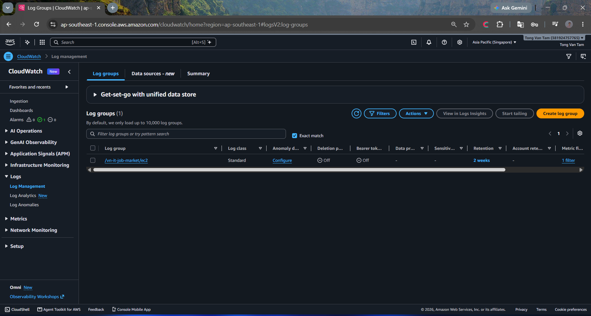
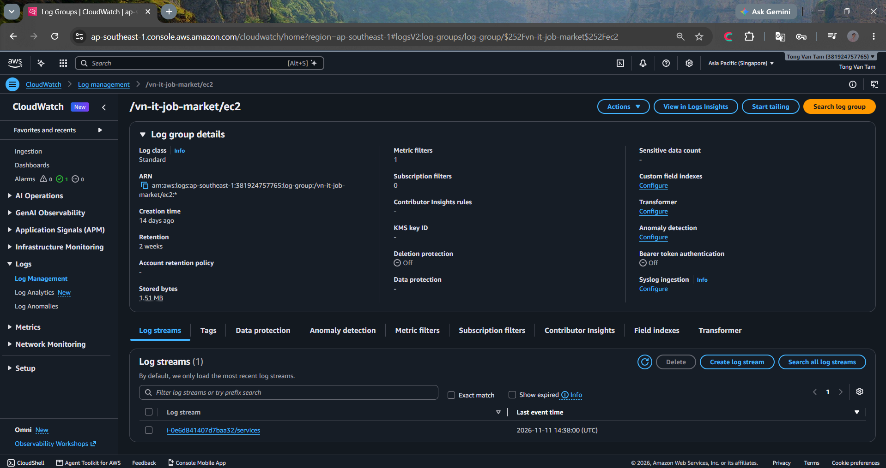
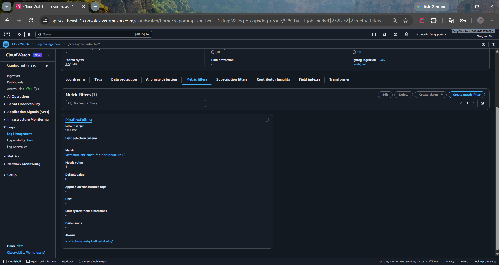
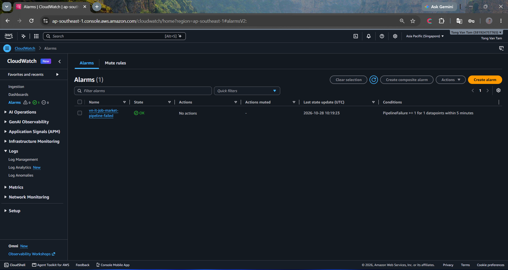
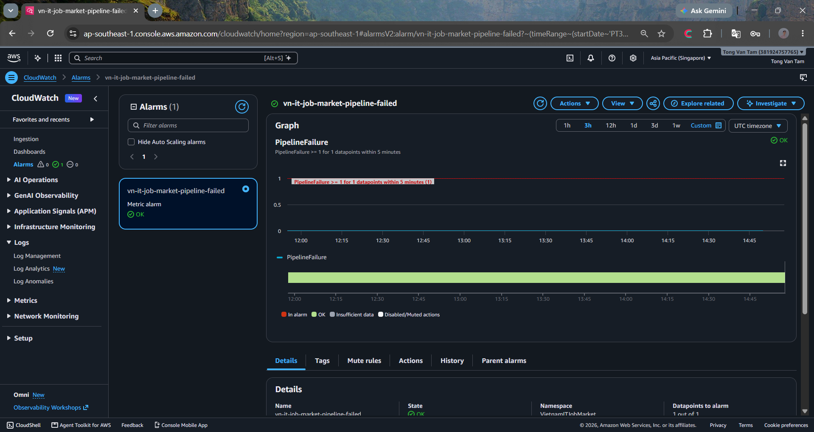
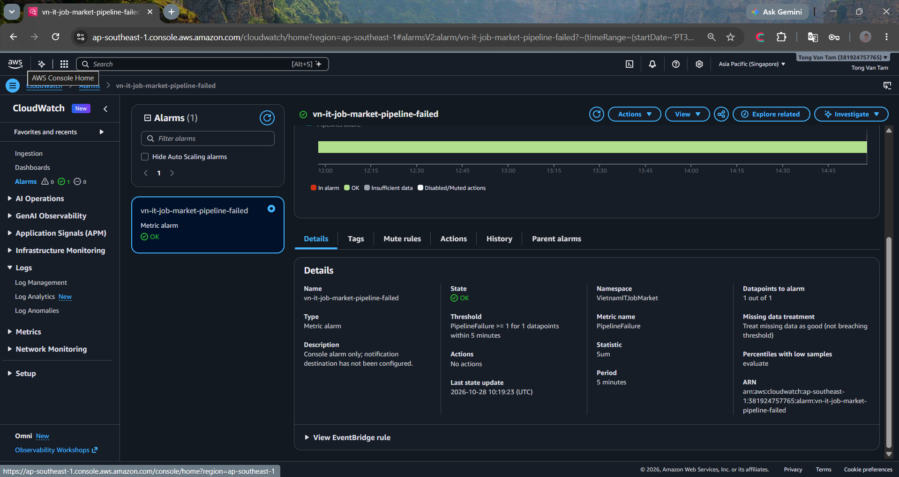

### Role in the system

CloudWatch centralizes operational logs for monitoring the pipeline and investigating errors. The PipelineFailure metric records error signals; the vn-it-job-market-pipeline-failed alarm monitors this metric. The EC2CloudWatchLogs policy permits EC2 to send logs to CloudWatch.

### Configuration used

| Component | Project configuration |
| --- | --- |
| Log group | /vn-it-job-market/ec2 |
| Namespace/metric | VietnamITJobMarket / PipelineFailure |
| Alarm | vn-it-job-market-pipeline-failed |
| Role policy cho log | EC2CloudWatchLogs |

The deployment retains logs for 14 days. The alarm sums errors over each 300-second period and enters the alarm state when at least one error is recorded in the evaluation period.

### Project log group

The **/vn-it-job-market/ec2** log group centralizes server logs for reviewing activity and investigating errors. Its **two-week** retention preserves recent logs while limiting storage duration. The screenshot shows the **Standard** class and **one metric filter**.

### Server log stream

The **i-0e6d841407d7baa32/services** stream stores service logs from the project's EC2 instance in this log group. Grouping logs by server identifies their origin during operational reviews.

### Convert log error signals into a metric

The **PipelineFailure** metric filter matches log events containing **"FAILED"** and records **1** in **VietnamITJobMarket / PipelineFailure**, with a default value of **0**. The alarm uses this metric to detect error signals in operational logs.

### Pipeline error alarm

The **vn-it-job-market-pipeline-failed** alarm monitors pipeline error signals using **PipelineFailure ≥ 1** for one data point within **five minutes**. It is **OK** in the screenshot. **No actions** means no notification or automatic response is attached.

The **PipelineFailure** graph displays metric values over time against the alarm threshold. In the displayed interval, the metric is **0** and the alarm is **OK**.

### Alarm evaluation settings

The alarm uses **Sum** for **PipelineFailure** over **five minutes** and triggers when one data point reaches **≥ 1**. Missing data is treated as not breaching, so the **OK** state should be reviewed alongside operational logs. The alarm currently provides Console monitoring without a notification destination.

---

[← 4.12. CloudWatch and monitoring](../) · [Workshop contents](../../) · [Next step →](../5.13.2-step2/)
