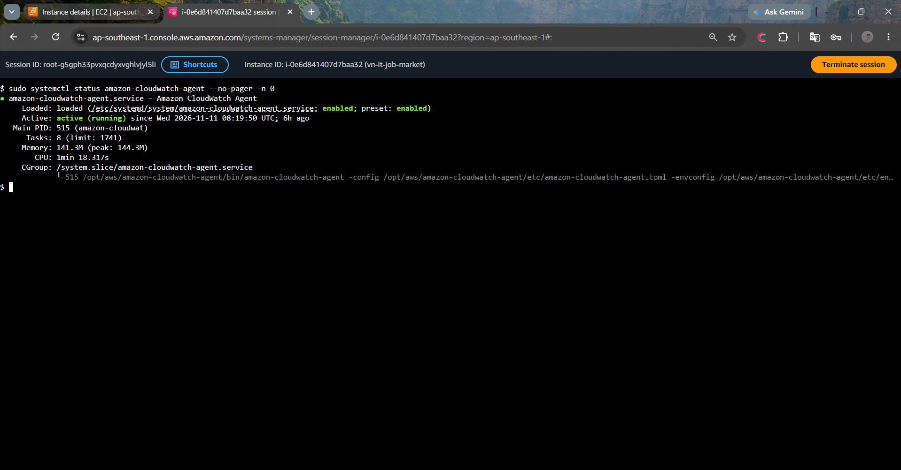
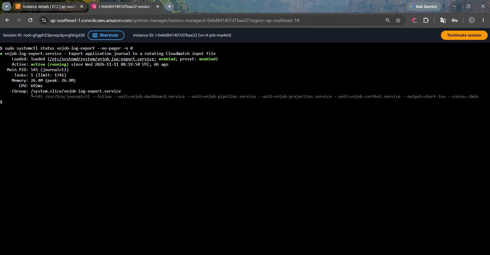

**Run in:** SSM on EC2 and the CloudWatch Console

### Objectives

Send operational journal logs to CloudWatch.

### Prerequisites

Log permissions and the log group from the previous step are available.

### Procedure

~~~bash
cd /opt/vn-it-job-market
sudo bash deploy/ec2/install_monitoring.sh
systemctl status amazon-cloudwatch-agent vnjob-log-export --no-pager
systemctl cat vnjob-log-export.service
~~~

The installer prepares CloudWatch Agent, the journal export service, and log-file rotation. Logs are sent to the instance stream in **/vn-it-job-market/ec2**.

Open CloudWatch → Logs → /vn-it-job-market/ec2, select the instance stream, and use the run's time interval. Open the alarm to inspect its metric, threshold, state, and actions.

### CloudWatch Agent status

CloudWatch Agent sends the configured EC2 logs to CloudWatch Logs for centralized monitoring. The output shows **active (running)** and **enabled**, allowing the service to start with the server.

```bash
sudo systemctl status amazon-cloudwatch-agent --no-pager -n 0
```




### Log exporter status

The **vnjob-log-export** service collects journal entries from the dashboard, pipeline, projection, and Certbot into the input file for CloudWatch Agent. It is **active (running)** and **enabled**, maintaining log collection after an EC2 restart.

```bash
sudo systemctl status vnjob-log-export --no-pager -n 0
```



---

[← 4.12. CloudWatch and monitoring](../) · [Workshop contents](../../) · [Previous step](../5.13.1-step1/)
