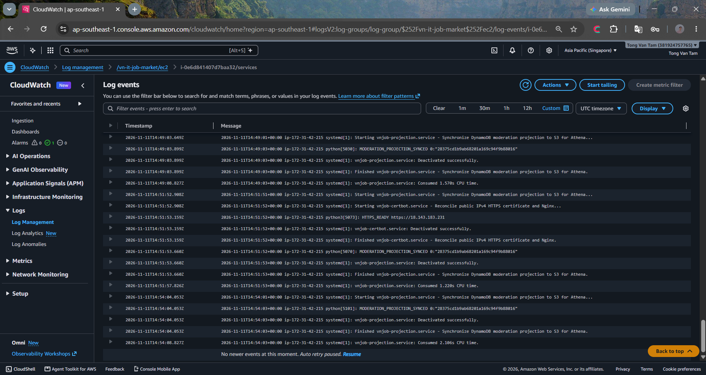
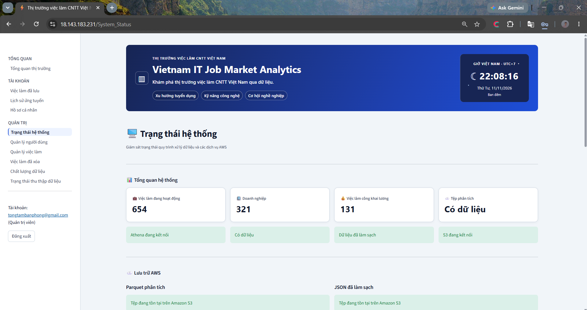
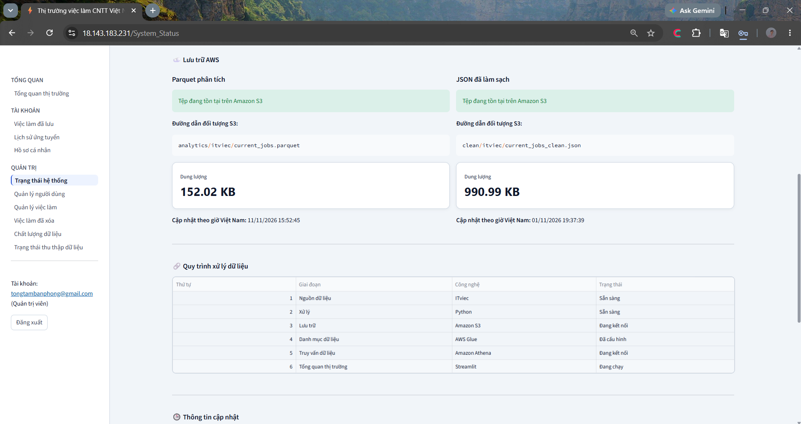
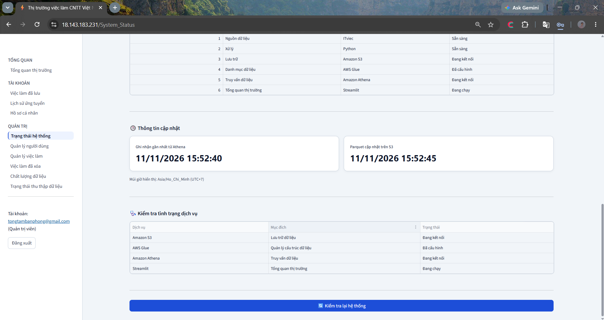
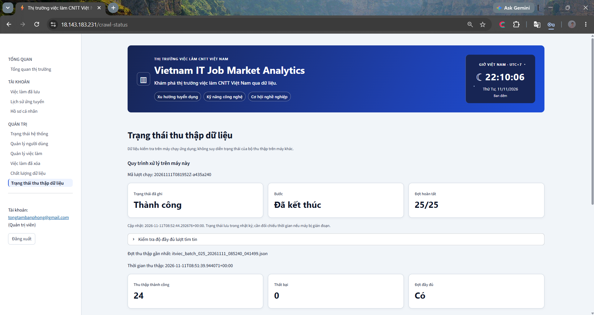
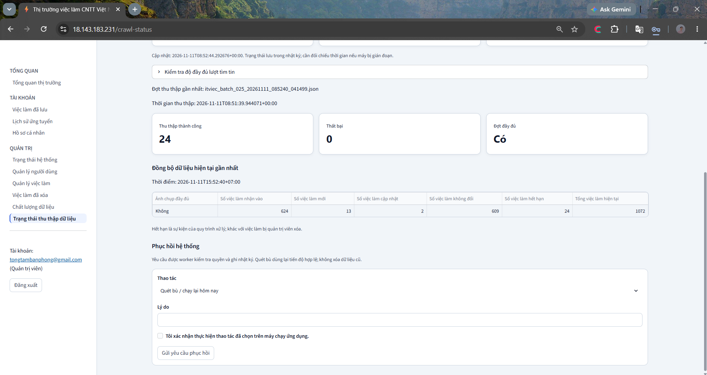
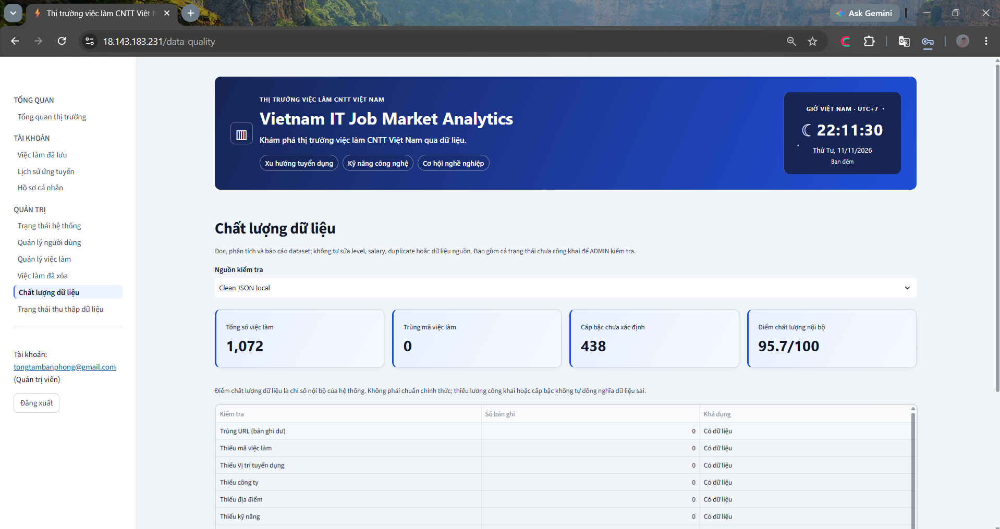
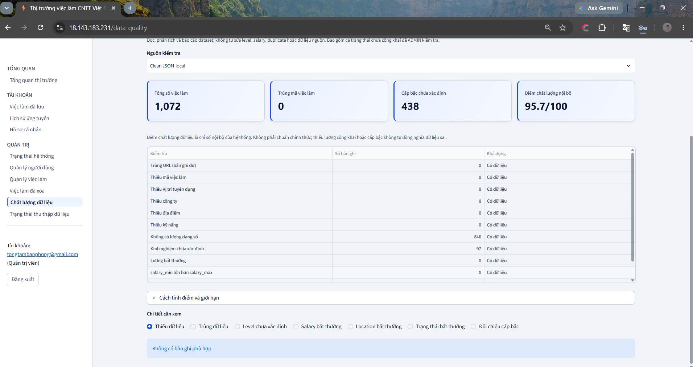

**Run in:** CloudWatch, the ADMIN website, and SSM

### Objectives

Use the administration pages and operational procedures after setup.

### Prerequisites

Logs/artifacts and ADMIN access are available.

### Procedure

Open System status, Data collection status, and Data quality. Compare the run_id, timestamps, stage, row counts, and warnings with artifacts/queries from the same run. An undisclosed salary differs from a missing required field.

~~~bash
sudo systemctl status vnjob-dashboard vnjob-pipeline vnjob-pipeline.timer --no-pager
sudo journalctl -u vnjob-pipeline.service -n 120 --no-pager
df -h /opt/vn-it-job-market
free -m
~~~

When an issue occurs, inspect logs to identify the failed stage and check network connectivity, permissions, or input data. Compare CloudWatch logs with the run state on EC2 before taking action.

### Monitor CloudWatch logs

Open **/vn-it-job-market/ec2** and select **i-0e6d841407d7baa32/services** to view events over time. Logs help track services and investigate issues.

The screenshot records **MODERATION_PROJECTION_SYNCED** from Projection Worker and **HTTPS_READY https://18.143.183.231** from the HTTPS management service. **Deactivated successfully** and **Finished** indicate successful service executions.

### Monitor system status on the website

Sign in as an administrator and select **Trạng thái hệ thống (System status)**. This page brings together data connectivity, stored files, and update timestamps for monitoring the application.

**System overview** shows 654 active jobs, 321 companies, and 131 jobs disclosing salaries. The page reports connected Athena and S3 services, available analytical data, and cleaned data.

**AWS storage and data processing** show file locations and processing components. The screenshot displays a 152.02 KB analytical Parquet file on S3 updated on 11 November 2026; the cleaned JSON file on S3 has a separate update date of 1 November 2026.

**Update information and service status** help track data freshness. The page shows the latest Athena record at 15:52:40 and the S3 Parquet update at 15:52:45 on 11 November 2026, Vietnam time; the service table lists S3, Glue, Athena, and Streamlit status.

### Monitor data collection status

Select **Trạng thái thu thập dữ liệu (Data collection status)** to review pipeline progress and synchronization results. Run **20261111T081952Z-a435a240** shows **Success**, **Finished**, and **25/25 completed batches**. The last batch collected **24 jobs**, with no failed jobs, and was recorded as complete.

The synchronization table records **624 incoming jobs**: **13 new**, **2 updated**, and **609 unchanged**; the current dataset contains **1,072 jobs**. It also records **24 expired jobs** and a complete-snapshot value of **No**. The **System recovery** form lets administrators request a catch-up scan or rerun for today, with a reason and confirmation.

### Monitor data quality

Select **Chất lượng dữ liệu (Data quality)** and choose **Clean JSON local** to inspect the cleaned EC2 dataset. The page identifies duplicates, missing fields, and unusual values; it does not automatically modify source data.

The screenshot shows **1,072 jobs**, **0 duplicate job IDs**, **438 jobs with an unknown level**, and an internal quality score of **95.7/100**.

The checks show **0 duplicate URLs** and no missing job IDs, titles, companies, locations, or skills. There are **846 records without numeric salaries** and **97 with unknown experience**; unusual salaries and salary_min greater than salary_max both have counts of **0**. Detail groups help administrators review relevant records. Missing salary or level information does not automatically mean incorrect data; the quality score is an internal indicator.

---

[← 4.13. CloudWatch and monitoring](../) · [Workshop contents](../../) · [Previous step](../5.13.2-step2/)
