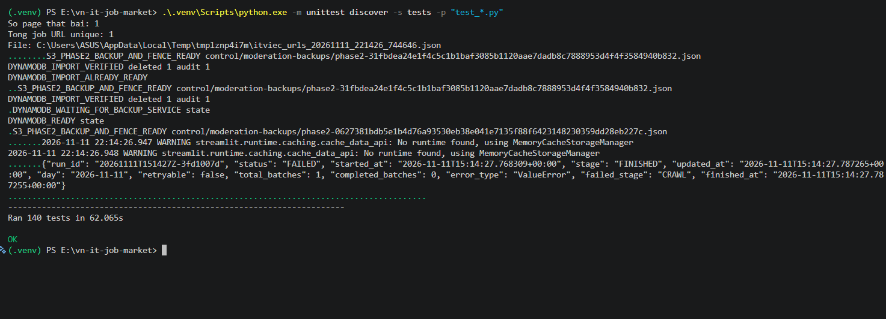
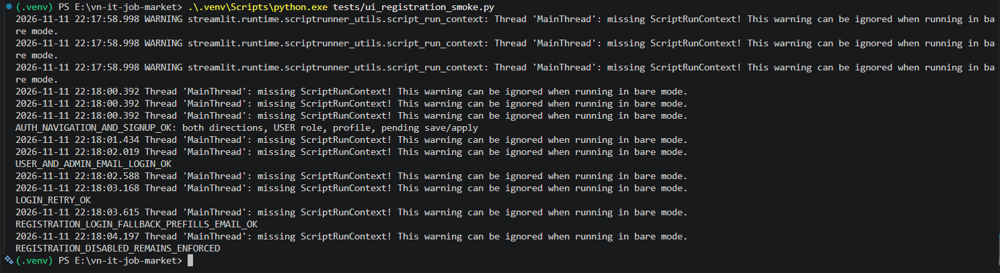
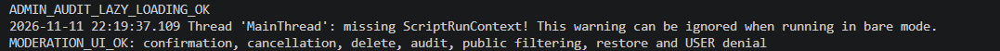
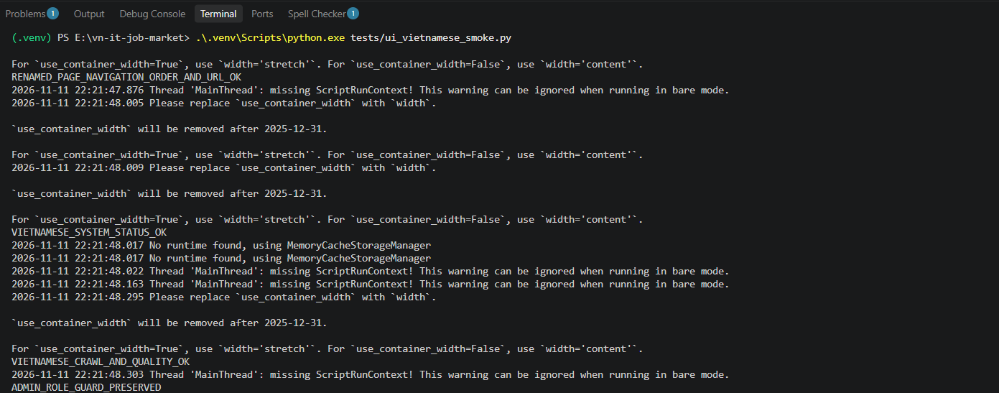

Testing on the development machine checks processing logic and interface flows before release. Tests performed on **11 November 2026** produced these results:

| Area | Result |
| --- | --- |
| Unit tests | 140 tests completed in 62.065 seconds; OK |
| Registration and sign-in | Authentication checks passed |
| Job moderation | Confirmation/cancellation, soft deletion, restoration, audit logging, and USER access restrictions passed in the test environment |
| Vietnamese interface | Navigation, monitoring pages, and ADMIN access restrictions passed |

**Unit test results**

**Registration and sign-in**

**Job moderation**

**Vietnamese interface**

---

[← 4.14. Testing and deployment verification](../) · [Workshop contents](../../) · [Next step →](../5.14.2-step2/)
