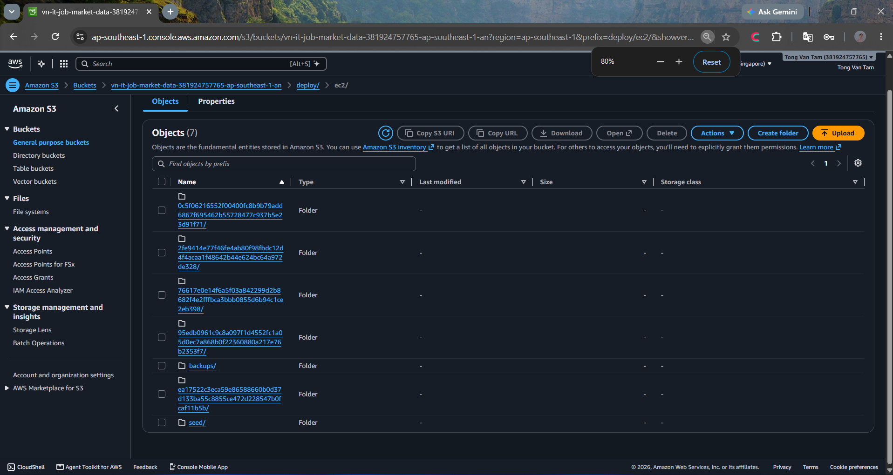
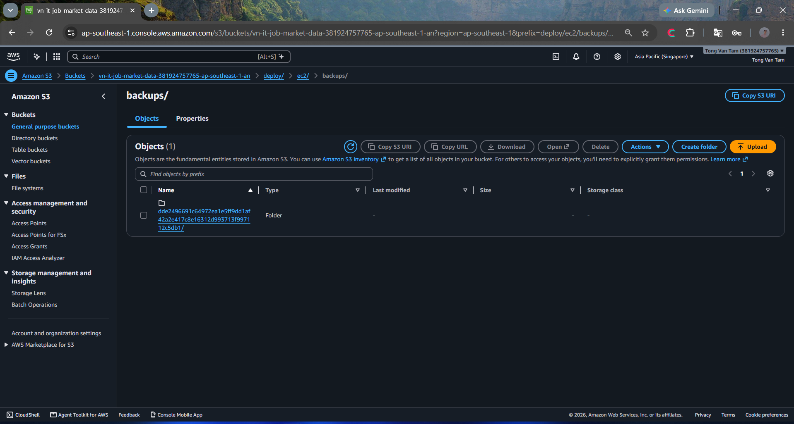
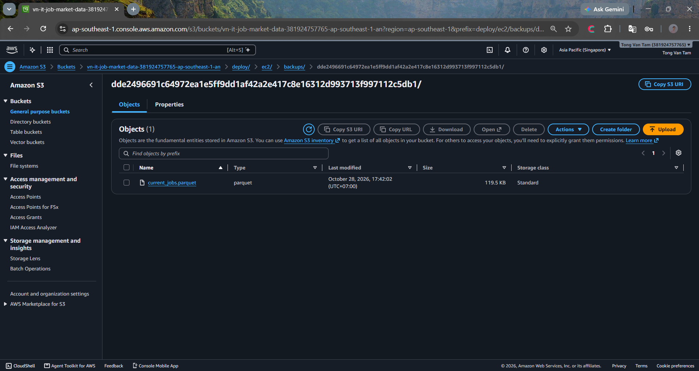

**Where:** AWS Console and the SSM terminal on EC2

### Objectives

Save a backup and verify recovery into a separate directory.

### Prerequisites

A private backup directory accessible to vnjob; a new ZIP filename and a destination that does not exist yet.

### Parquet backup on Amazon S3

The backup preserves a version of the analytical data for recovery. In the project bucket, open **deploy/ → ec2/ → backups/**.

Open the backup directory inside **backups/**.

The backup contains **current_jobs.parquet**, sized **119.5 KB**, updated on **28 October 2026 at 17:42:02 (UTC+07:00)**. This version is stored separately from the analytical file currently used under **analytics/itviec/**.

### Backup and recovery verification with the project tool

~~~bash
cd /opt/vn-it-job-market
sudo -u vnjob .venv/bin/python deploy/ec2/backup_data.py backup /duong-dan-rieng/backup-moi.zip
sudo -u vnjob .venv/bin/python deploy/ec2/backup_data.py verify-restore /duong-dan-rieng/backup-moi.zip --destination /duong-dan-rieng/restore-thu-moi
~~~

Replace the path in the command with the prepared backup directory. **backup** creates a new ZIP archive and locks pipeline operations during backup. **verify-restore** checks the file manifest, sizes, and SHA256 before extracting into a new directory.

The **--s3-bucket** option includes S3 objects within the tool's scope; DynamoDB backup is managed separately. After recovery, check JSON record counts and the Parquet schema before using the data.

### Recovery verification outcome

The backup passes integrity checks and is extracted into a separate directory, preserving the running application's data.

---

[← 4.13. Data Backup and Recovery Verification](../) · [Workshop contents](../../)
