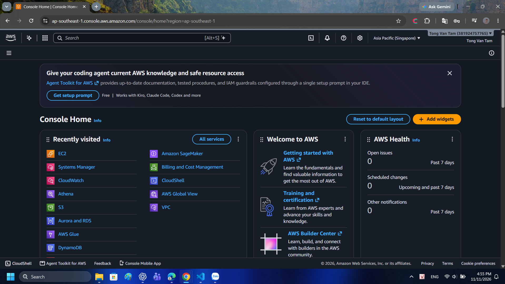
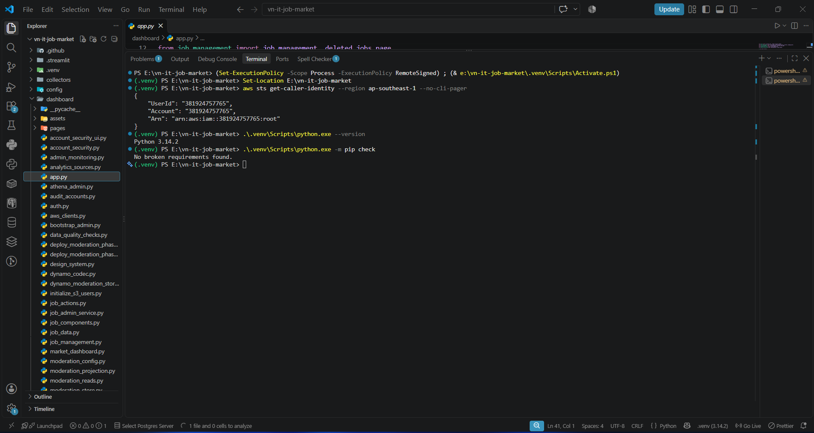

**Where:** Windows administration computer and AWS Console

### Objectives

Prepare to work with the correct AWS account and project source.

### Prerequisites

Project source at E:\vn-it-job-market and its .venv environment.

### Procedure

1. Sign in to AWS using the method configured on the administration computer.
2. Select **Singapore** in the Console.

3. Open PowerShell in the project directory and check credentials and runtime:

~~~powershell
Set-Location E:\vn-it-job-market
aws sts get-caller-identity --region ap-southeast-1 --no-cli-pager
.\.venv\Scripts\python.exe --version
.\.venv\Scripts\python.exe -m pip check
~~~

The Windows administration computer packages source code and manages AWS. On EC2, the deployment script creates a separate Python environment and installs libraries from `requirements.txt`.

### Check the results

The checks show that the administration computer connects to AWS account `381924757765` and uses Python **3.14.2**. `pip check` returns **No broken requirements found.**, indicating no dependency conflicts detected in the current environment.

---

[← 4.2. Preparation](../) · [Workshop contents](../../) · [Next step →](../5.2.2-step2/)
