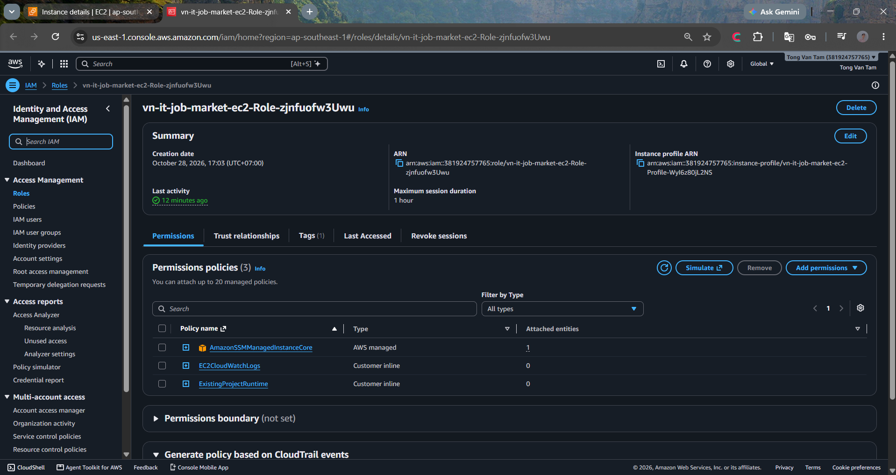

**Where:** Administration computer, S3, Glue, and DynamoDB

### Objectives

Identify the data components and IAM role used by EC2.

### Prerequisites

Administrative access to project resources and a copy of existing data.

### Project data

| Component | Role |
| --- | --- |
| Job data on EC2 | Store current data and change history |
| Parquet on S3 | Supply analytical data |
| Glue Data Catalog | Store table definitions for Athena |
| DynamoDB | Store moderation state and operation audit logs |
| User data on S3 | Store accounts and personal activity |

### EC2 permissions

EC2 uses an IAM role so programs on the server access AWS services with temporary credentials. The project role has three policies:

- **AmazonSSMManagedInstanceCore**: enables EC2 management and access through Systems Manager.
- **EC2CloudWatchLogs**: permits sending operational logs to CloudWatch.
- **ExistingProjectRuntime**: permits access to AWS resources used by the application and pipeline according to project configuration.

### Result

The IAM role grants EC2 permissions for Systems Manager, log delivery, and access to system resources.

---

[← 4.2. Preparation](../) · [Workshop contents](../../) · [Previous step](../5.2.1-step1/)
