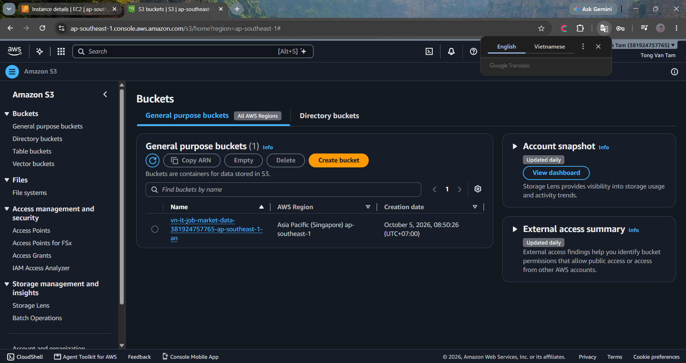
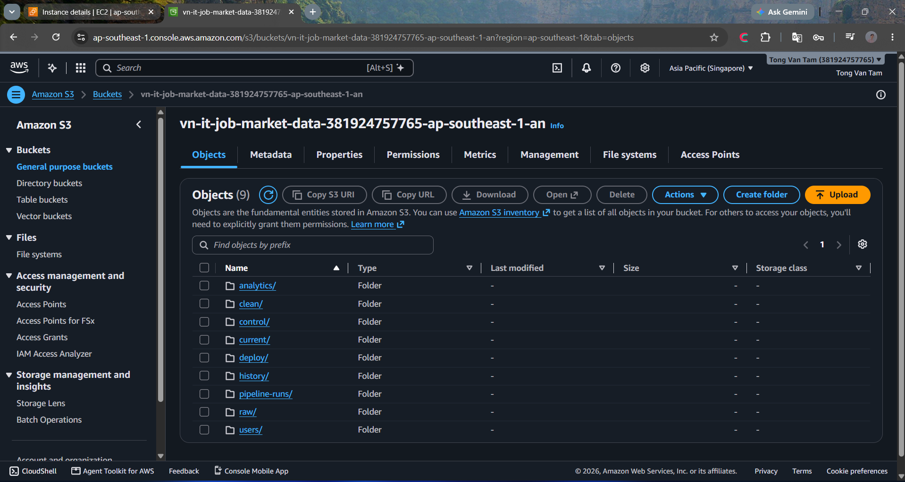
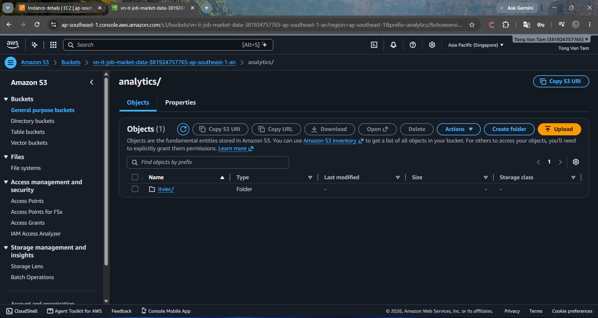
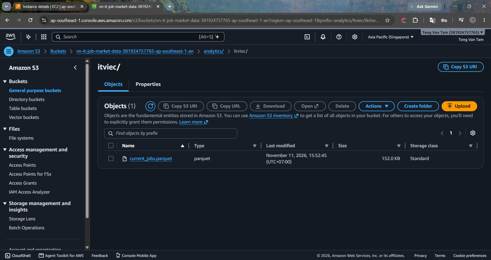
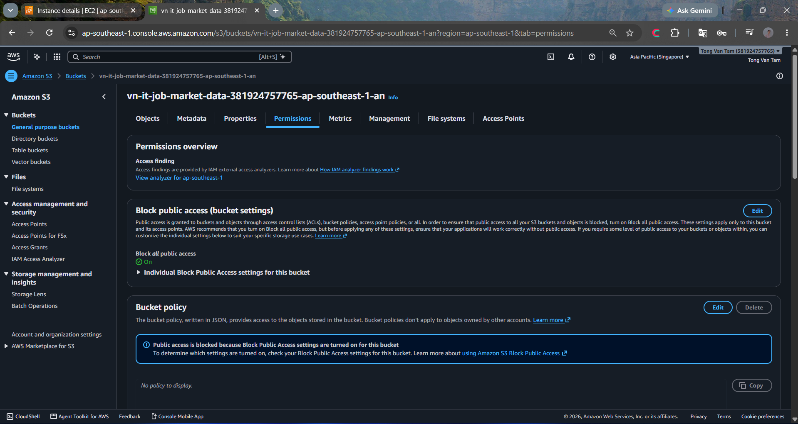
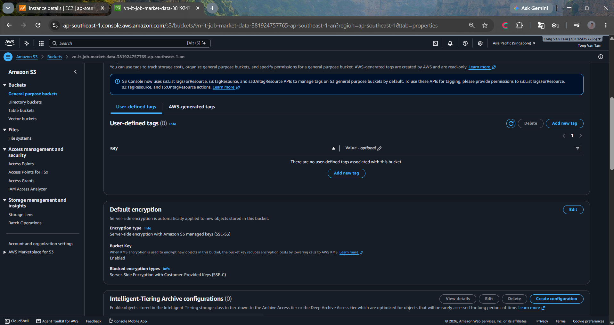

### Configuration used

Project bucket: **vn-it-job-market-data-381924757765-ap-southeast-1-an**, Region **ap-southeast-1**.

| Bucket path | Stored data |
| --- | --- |
| analytics/itviec/current_jobs.parquet | Job data in Parquet for Athena |
| pipeline-runs/&#60;run_id&#62;/ | Output files for each pipeline run |
| users/ | Accounts and personal activity |
| control/moderation/job_moderation.json | Job moderation snapshot |
| control/athena-results/ | Athena query results |
| deploy/ec2/ | EC2 deployment files |

The **Objects** tab lists `analytics/`, `clean/`, `control/`, `current/`, `deploy/`, `history/`, `pipeline-runs/`, `raw/`, and `users/`.

**analytics/itviec/** holds processed job data for analysis, separate from accounts, pipeline logs, and operational configuration. Glue Data Catalog references this directory so Athena can locate its data.

**current_jobs.parquet** stores current job data after cleaning and normalization. Parquet uses compressed columnar storage, allowing Athena to read the columns needed by a query. The dashboard uses query results for KPIs, charts, and job listings.

### Bucket access

**Block Public Access** prevents public exposure of bucket data, protecting job files, accounts, and personal activity. EC2 reads and writes using its authorized IAM role. Users access data through the dashboard instead of directly accessing the bucket. The project enables **Block all public access (On)**.

### Encryption at rest

The bucket's default encryption uses **SSE-S3** for newly written objects to protect stored data. Amazon S3 manages keys, encrypts writes, and decrypts authorized reads; the application does not manage encryption keys itself. This protects data at rest, while IAM and Block Public Access control access.

---

[← 4.3. Amazon S3 Storage Setup](../) · [Workshop contents](../../) · [Next step →](../5.3.2-step2/)
