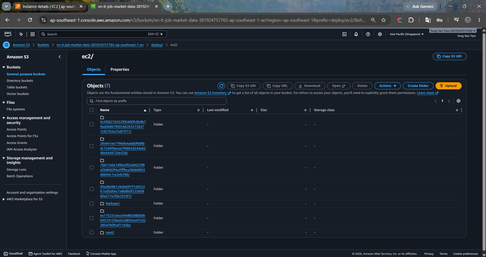
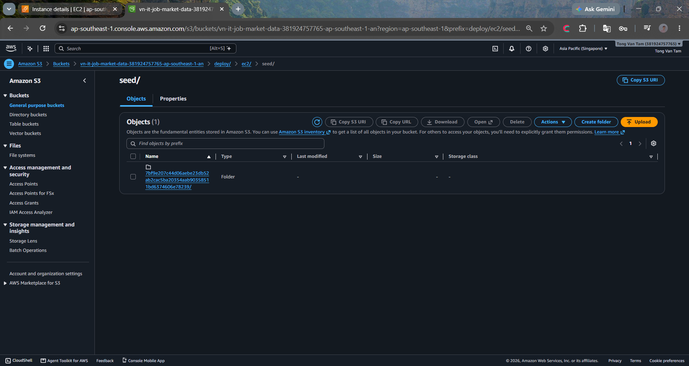
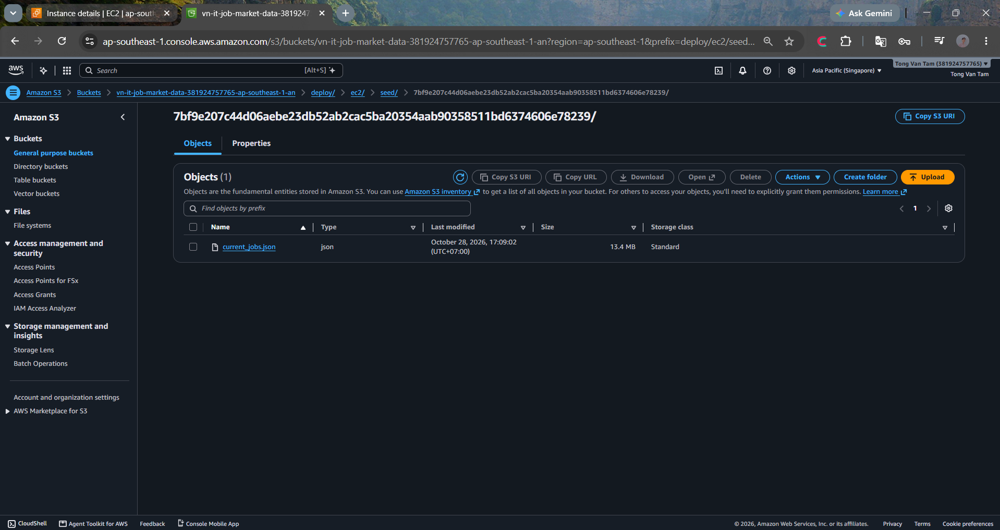

### Analytical data on S3

**analytics/itviec/current_jobs.parquet** supplies data to Athena and the dashboard. The pipeline updates this object after processing and validation. Keeping one Parquet file at the analytical location prevents Athena from reading multiple copies of the same dataset.

### Seed data for EC2 deployment

**current_jobs.json** under **deploy/ec2/seed/** initializes current job data on the server during deployment and preserves existing **first_seen** and **last_seen** values. This allows tracking to continue from previous data rather than restarting its entire history.

The seed is stored in a directory named after its content's SHA-256 digest. The digest verifies integrity after downloading to EC2, helping detect changes or an incorrect version. The seed initializes data; the pipeline continues updating current data on EC2 during operation.

### Seed data location

**1. deploy/ec2/** contains deployment packages and data, including **seed/**.

**2. seed/** contains a subdirectory named after the SHA-256 digest to identify the seed version.

**3. The SHA-256 directory** contains **current_jobs.json** for initializing EC2 data.

---

[← 4.3. Amazon S3 Storage Setup](../) · [Workshop contents](../../) · [Previous step](../5.3.1-step1/)
