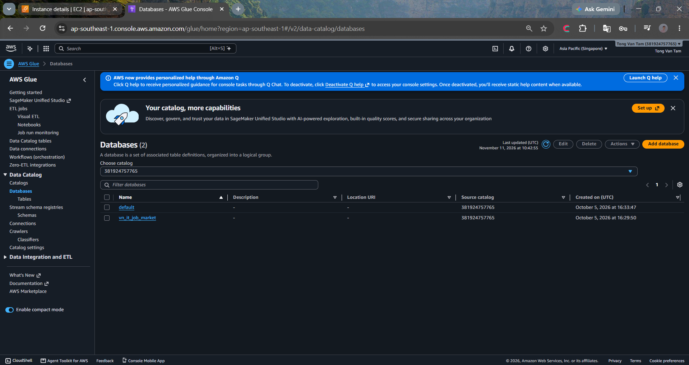
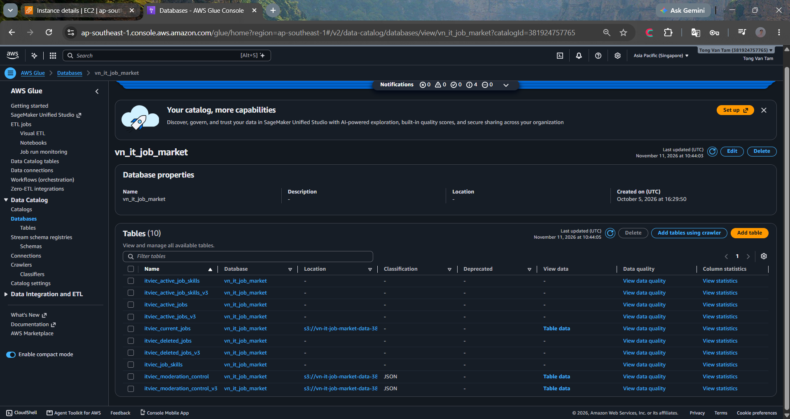
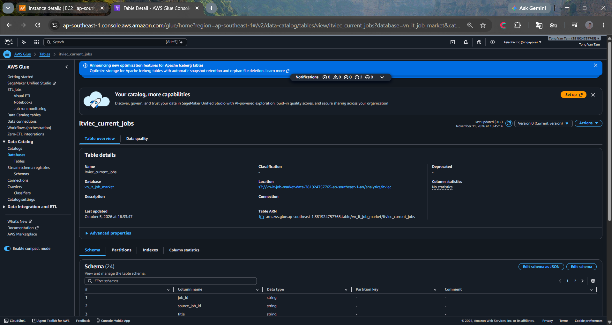
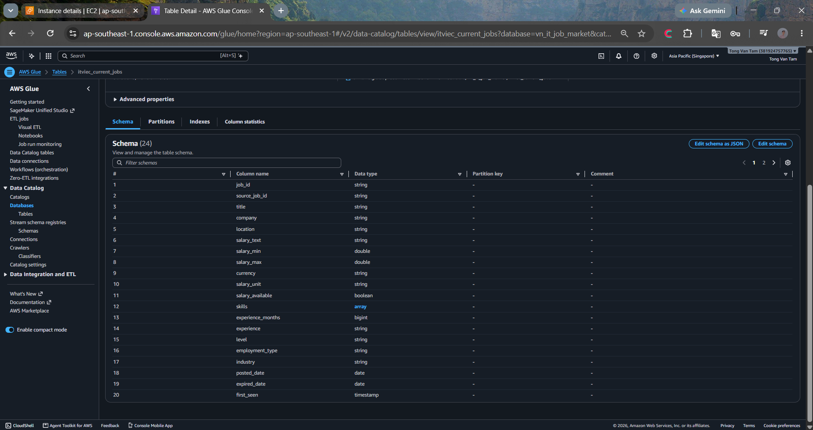
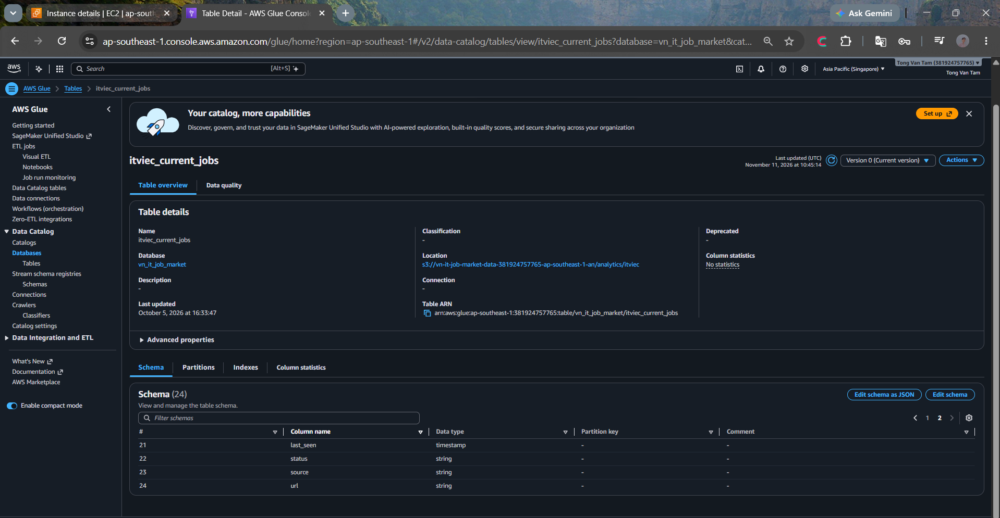
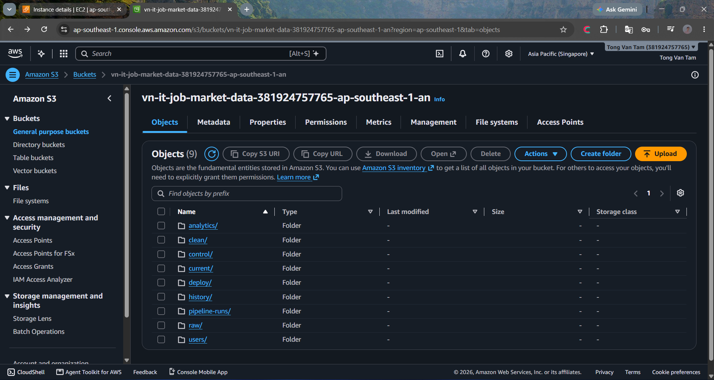
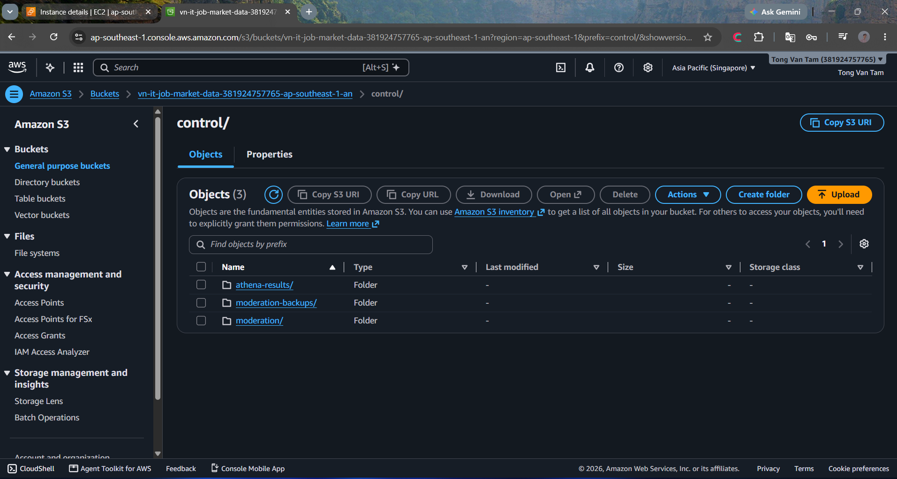
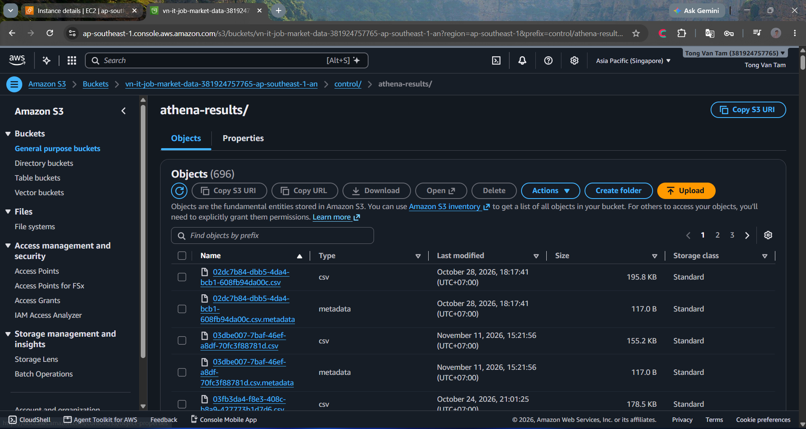

### Role in the system

Glue Data Catalog stores column names, data types and the Parquet location so that Athena can read S3 data correctly. Athena runs SQL queries for the dashboard; query results are stored separately under control/athena-results/, away from the analytical input data.

### Project database

The **vn_it_job_market** database groups job-data table and view definitions in Glue Data Catalog. Athena uses these definitions to identify the structure and location of the data to query. Parquet data is stored in S3; this database stores query metadata.

### Source table and analytical views

The **itviec_current_jobs** table describes the job data in the Parquet file on S3. The **itviec_active_jobs** and **itviec_active_job_skills** views provide jobs and skills after moderation filtering for the dashboard's job list, KPIs and charts. **itviec_deleted_jobs** and **itviec_moderation_control_v3** help identify jobs to exclude from public results.

### Configuration used

| Setting | Project value |
| --- | --- |
| Data source | AwsDataCatalog |
| Database | vn_it_job_market |
| Source table | itviec_current_jobs |
| Workgroup runtime | primary |
| Table location | s3://vn-it-job-market-data-381924757765-ap-southeast-1-an/analytics/itviec/ |
| Query result location | s3://vn-it-job-market-data-381924757765-ap-southeast-1-an/control/athena-results/ |

### Data location and table structure

The table's **Location** points to **analytics/itviec/** on S3, allowing Athena to locate the Parquet dataset. The **Schema** defines column names and data types so that job IDs, titles, skills, salaries and timestamps follow a consistent structure. The project table has **24 columns**; the first columns are **job_id**, **source_job_id** and **title**, all of type **string**.

Columns are defined for their intended use: **salary_min/salary_max** are numeric for salary queries; **salary_available** is a boolean for filtering jobs with disclosed salaries; **skills** is an array for skill statistics; **experience_months** stores months of experience. **posted_date**, **expired_date** and **first_seen** support time filtering and job tracking.

### Storing Athena query results

**control/athena-results/** stores query result files so that the application can retrieve the data returned by Athena. Keeping results separate from **analytics/itviec/** separates analytical input and output data. The application specifies this output location when submitting queries to Athena.

In the project bucket, **control/** groups operational data.

Within **control/**, **athena-results/** stores query results; **moderation/** and **moderation-backups/** store moderation data and backups.

**.csv** files contain the rows returned by queries; their accompanying **.csv.metadata** files store result metadata used by Athena when reading results. Filenames based on query execution IDs link S3 results to Athena query history.

---

[← 4.4. Setting up Glue Data Catalog and Athena](../) · [Workshop contents](../../) · [Next step →](../5.4.2-step2/)
