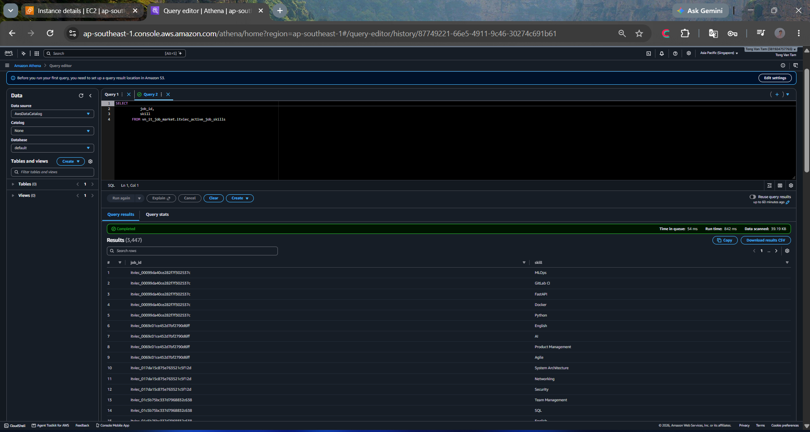

**Run in:** Athena Query editor

### Purpose

Retrieve skills from jobs eligible for display as input for dashboard skill statistics. Athena reads S3 data through the tables and views defined in Glue Data Catalog.

### Skill query for the dashboard

The **itviec_active_job_skills** view provides job–skill pairs after moderation filtering. The dashboard uses this data to count skills appearing in job listings. One job can have multiple skills, so the result row count is not the number of jobs.

~~~sql
SELECT job_id, skill
FROM vn_it_job_market.itviec_active_job_skills;
~~~

The saved query has status **Completed**, returning **3,447 rows**, with a runtime of **842 ms** and **39.19 KB** scanned.

---

[← 4.4. Setting up Glue Data Catalog and Athena](../) · [Workshop contents](../../) · [Previous step](../5.4.1-step1/)
