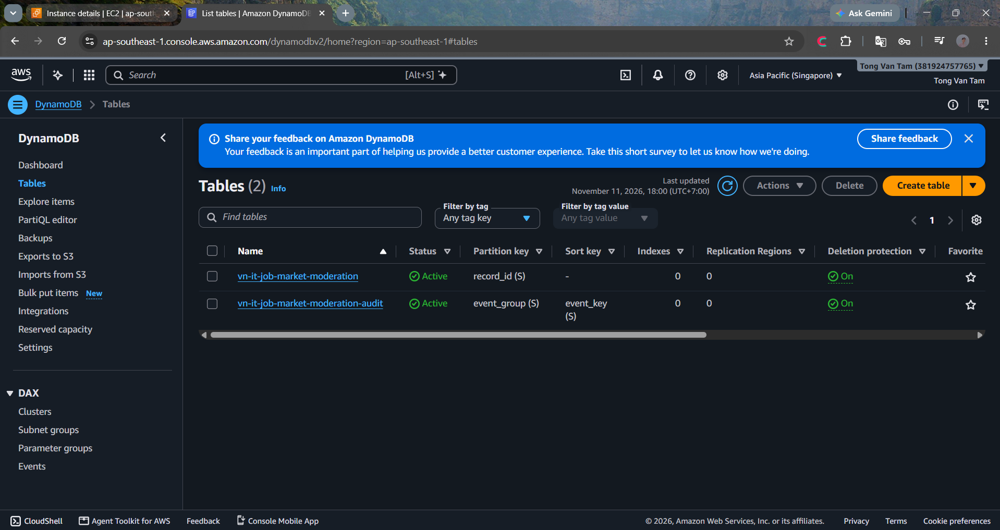
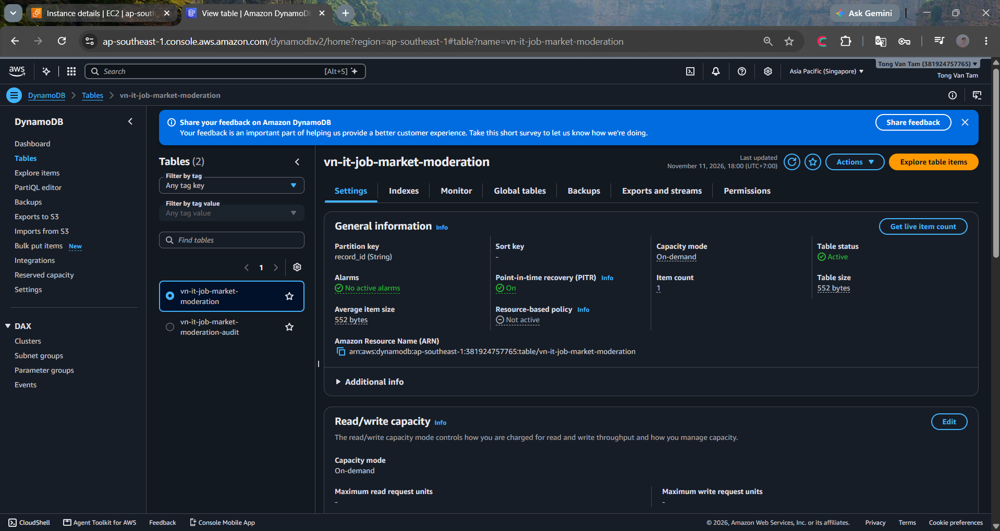
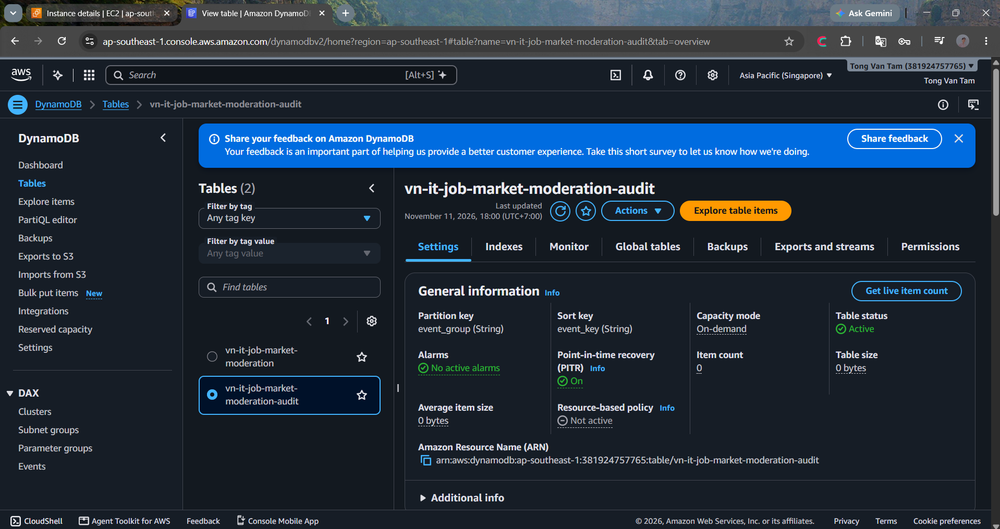

### Role in the system

DynamoDB stores job moderation state and administrative audit events. The moderation table manages current state; the audit table stores change events for tracking actions. Separate tables support state lookups and history queries for their respective purposes.

### Configuration used

| Table | Key | Role |
| --- | --- | --- |
| vn-it-job-market-moderation | record_id String | Moderation state and control metadata |
| vn-it-job-market-moderation-audit | event_group String + event_key String | Audit theo revision |

Moderation actions and audit logging use these two tables. Accounts and personal activity are stored separately in S3.

**Deletion protection** protects both tables from accidental deletion.

### Moderation table configuration

**vn-it-job-market-moderation** uses **record_id (String)** to identify moderation state and control records. **On-demand** capacity handles reads and writes without preallocating capacity units, suiting irregular administrative activity.

**Point-in-time recovery (PITR)** is enabled to restore data to a point within the retained recovery period following unwanted changes. It provides protection in addition to Deletion protection.

### Audit table configuration

**vn-it-job-market-moderation-audit** stores moderation change events for reviewing administrative actions. **event_group** groups events; **event_key** distinguishes events within a group. The table uses **On-demand** capacity and has **PITR** enabled for recovery.

---

[← 4.5. Setting up DynamoDB and moderation data](../) · [Workshop contents](../../) · [Next step →](../5.5.2-step2/)
