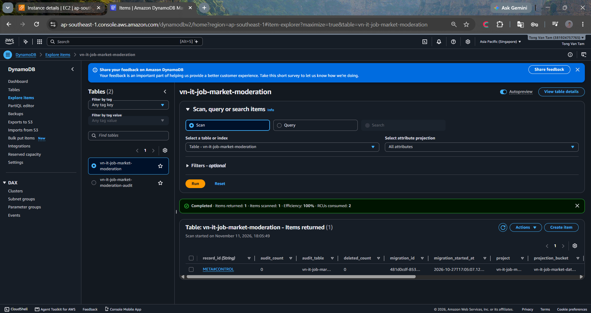
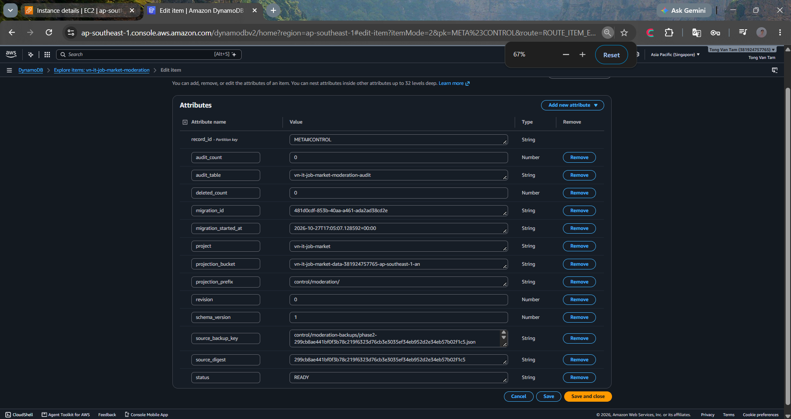
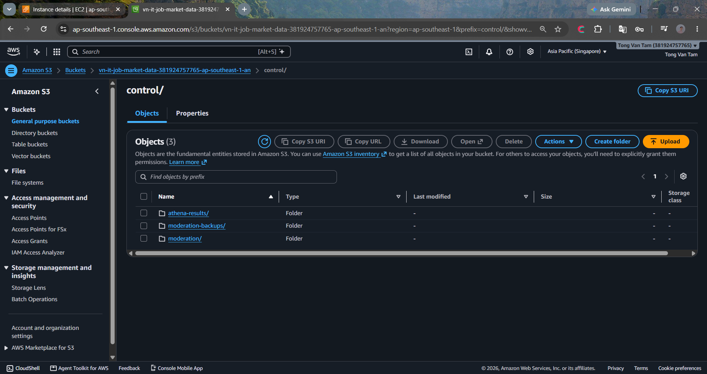
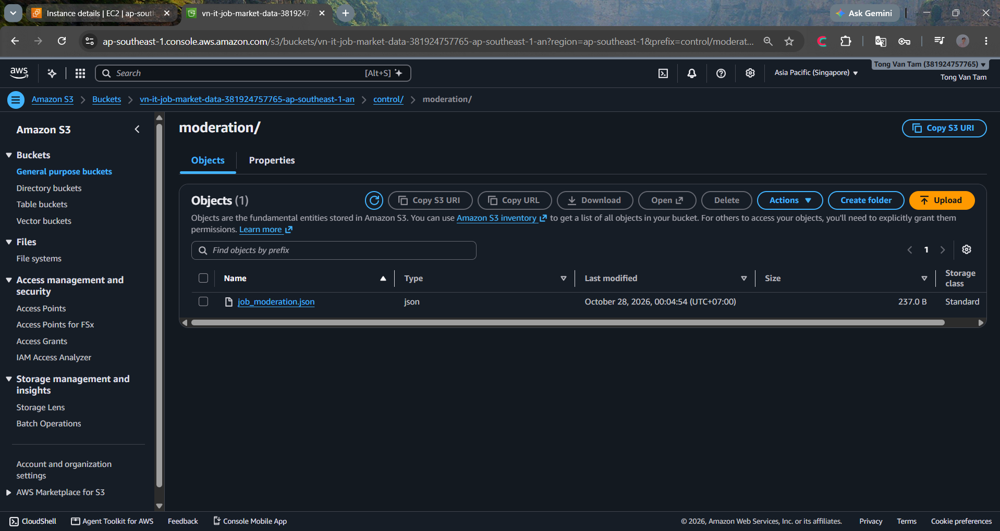
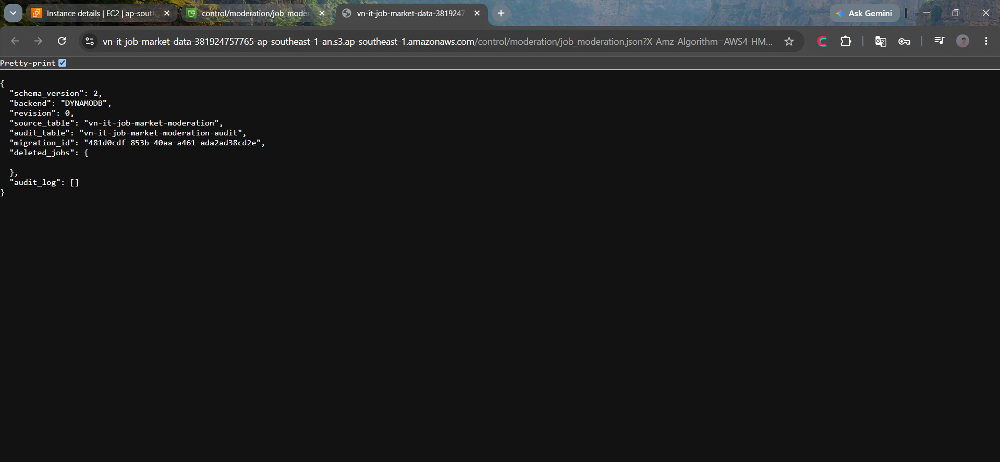

### Role in the system

The view layer ensures that the dashboard uses only jobs eligible for display. The Projection Worker converts DynamoDB moderation state into an S3 snapshot for Athena filtering; job and skill views apply the same moderation state.

### Configuration used

The application uses DynamoDB as the primary moderation source. META#CONTROL contains state/revision information; the Projection Worker exports an S3 snapshot with schema_version=2 and backend=DYNAMODB for Athena.

### Moderation control record

**META#CONTROL** stores moderation backend control information, including the change revision and S3 snapshot synchronization settings. The application and Projection Worker use it to coordinate moderation updates between DynamoDB and the data read by Athena.

**READY** indicates that the moderation backend is ready according to the control record. **revision** tracks changes; **projection_bucket** and **projection_prefix** identify the S3 output location at **control/moderation/**. **audit_table** specifies the audit table.

### Moderation snapshot on S3

**control/moderation/** stores the moderation snapshot read by Athena. The Projection Worker reads DynamoDB state and exports it here, allowing analytical queries to apply administrators' moderation decisions.

**job_moderation.json** supplies moderation data to Athena tables and views. The views use it to exclude soft-deleted jobs from public results.

The snapshot uses **schema_version: 2** and **backend: DYNAMODB** to identify its structure and moderation source. **revision** allows comparison with DynamoDB; **deleted_jobs** supplies soft-deleted job IDs for Athena filtering. In this snapshot, revision is **0**, and deleted_jobs and audit_log are empty.

---

[← 4.5. Setting up DynamoDB and moderation data](../) · [Workshop contents](../../) · [Previous step](../5.5.1-step1/) · [Next step →](../5.5.3-step3/)
