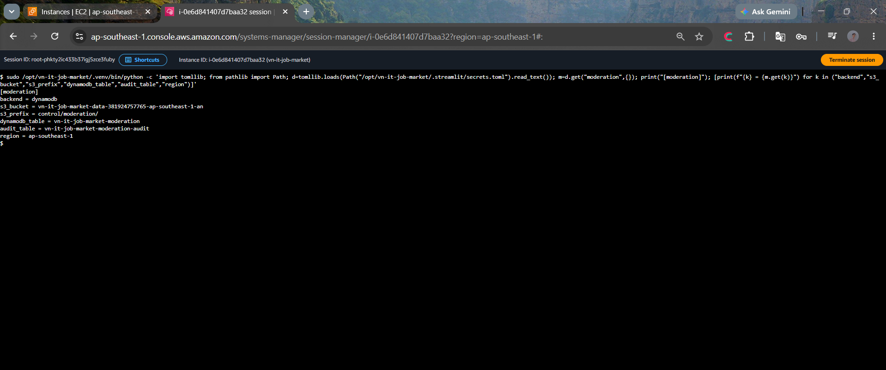
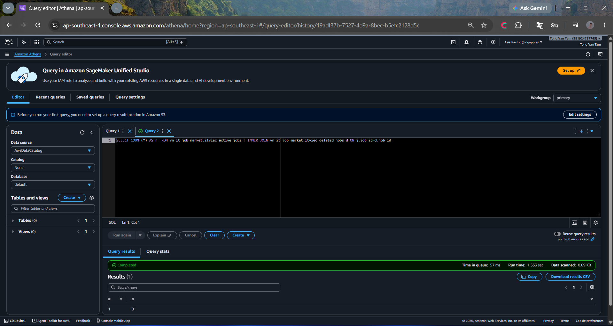

### Connecting the application to moderation data

The application uses DynamoDB for moderation state and administrative audit logging, and an S3 snapshot for Athena to filter soft-deleted jobs.

### Checking jobs after moderation

The query compares job IDs between the public and soft-deleted views. A result of 0 means no job appears in both datasets at the time of the check.

~~~sql
SELECT COUNT(*) AS n
FROM vn_it_job_market.itviec_active_jobs j
INNER JOIN vn_it_job_market.itviec_deleted_jobs d
ON j.job_id = d.job_id;
~~~

The query result on **28 October 2026** was **n = 0**: the two views had no overlapping job IDs in this check. This checks displayed data consistency; it does not replace testing soft deletion and restoration.

---

[← 4.5. Setting up DynamoDB and moderation data](../) · [Workshop contents](../../) · [Previous step](../5.5.2-step2/)
