### Role in the system

EC2 runs the data collection and processing pipeline, Streamlit Dashboard, and workers. The IAM Role grants programs on the server access to AWS services. IMDSv2 requires a session to access instance metadata, helping protect metadata and temporary credentials.

### Infrastructure management with CloudFormation

The **vn-it-job-market-ec2** stack manages the EC2 instance, IAM Role, and Security Group. The **vn-it-job-market-ec2-public** stack manages web ingress rules, separating access configuration from server infrastructure. CloudFormation manages these resources using the project's deployment configuration.

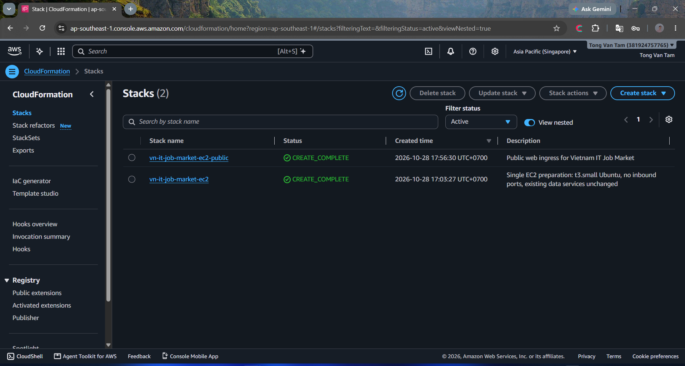

**Outputs** provide the instance and security group IDs used for administration, SSM connections, and web access configuration.

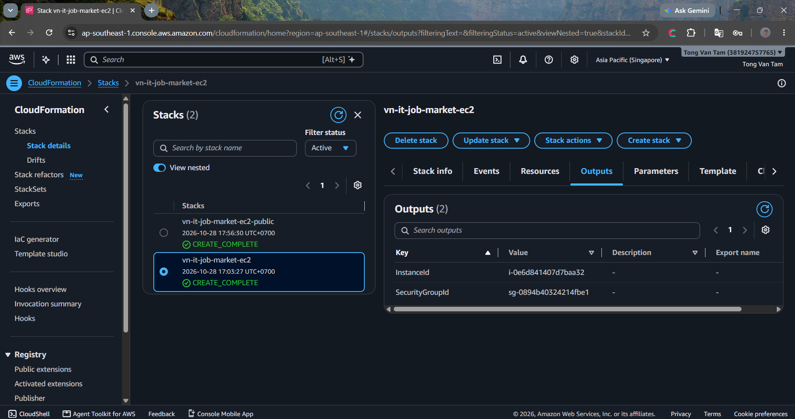

### EC2 instance

| Component | Project configuration |
| --- | --- |
| EC2 | vn-it-job-market — i-0e6d841407d7baa32 |
| Region | ap-southeast-1 |
| Instance type | t3.small |
| OS and volume in the deployment records | Ubuntu 24.04, encrypted 30 GiB gp3 volume |
| Metadata | IMDSv2 Required |
| Stack | vn-it-job-market-ec2 |
| Source runtime | /opt/vn-it-job-market |

The source package is stored on S3 and transferred to EC2 during deployment. The CloudFormation stack manages EC2 infrastructure and its IAM Role according to the project configuration.

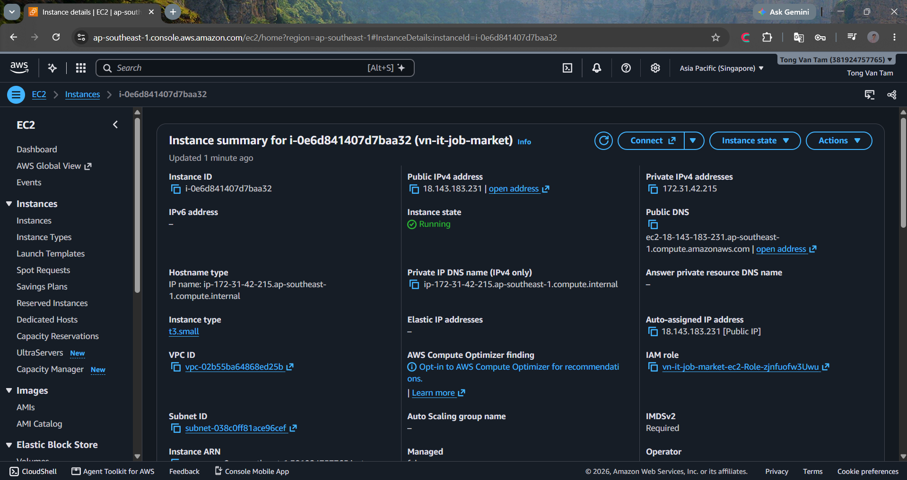

### Server storage

The **Amazon EBS gp3** volume stores the operating system, source code, Python environment, and processing data on EC2. EBS encryption protects data at rest.

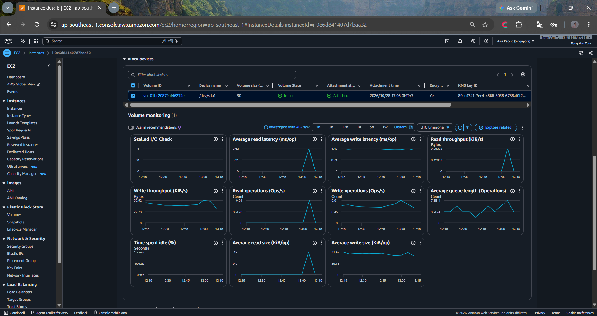

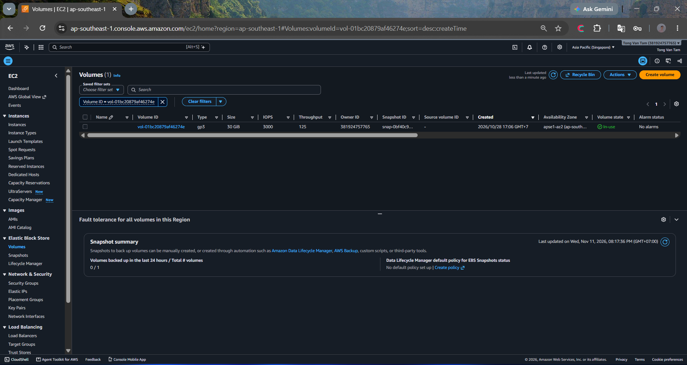

### Source package on S3

The **source.tar.gz** package contains the application code transferred to EC2 during deployment. Releases are stored separately under **deploy/ec2/** to identify the correct source package.

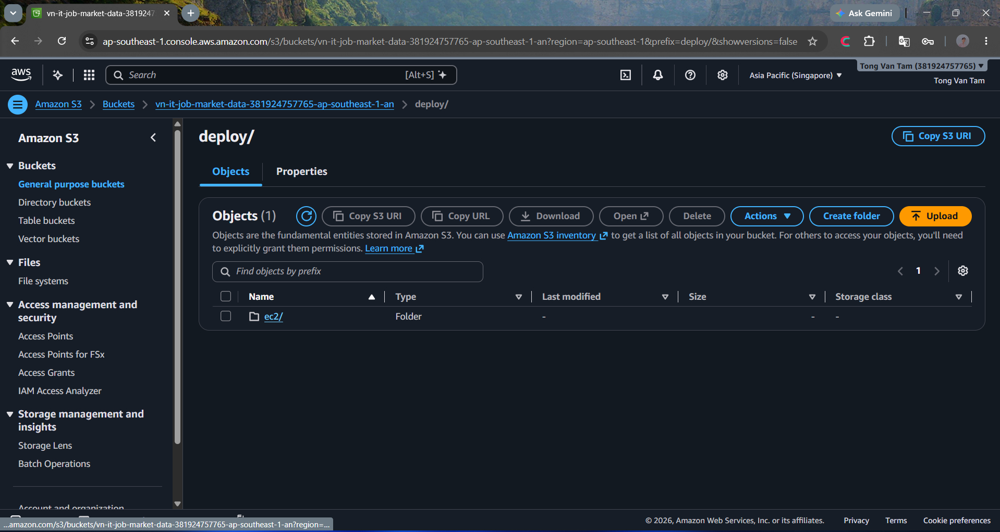

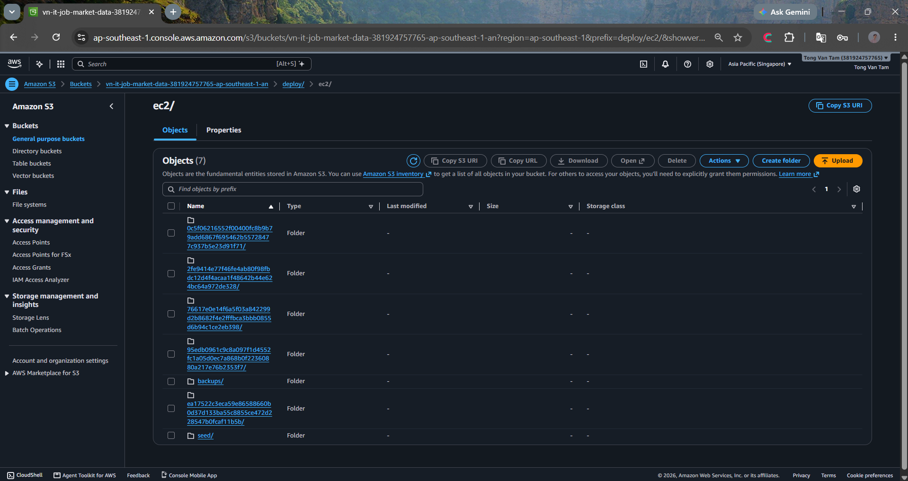

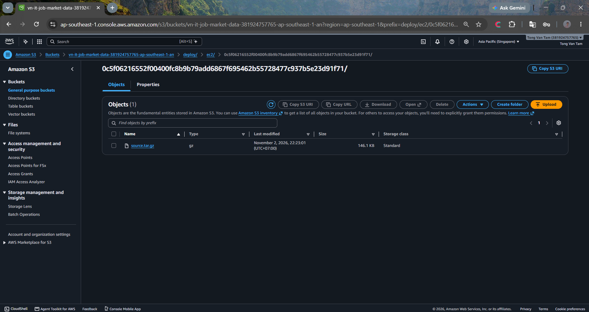

The **Key** and **S3 URI** identify the exact object the server downloads during deployment.

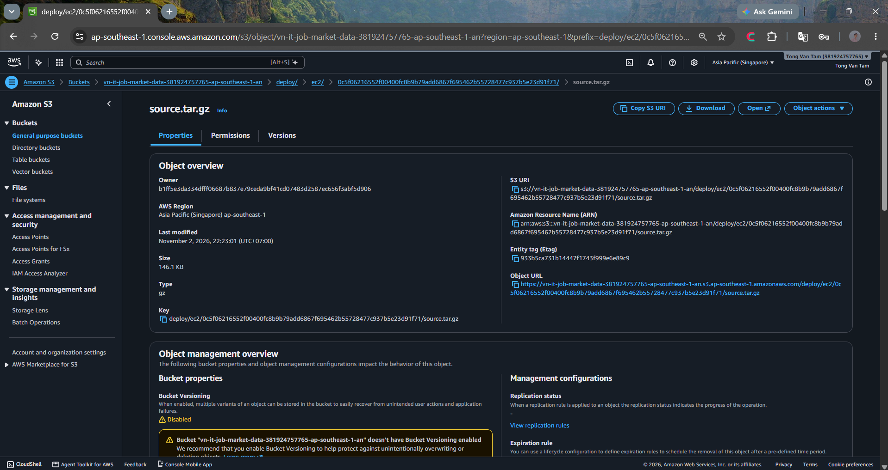

The **SHA-256** check compares the package contents with the release identifier to detect an incorrect download or a modified package.

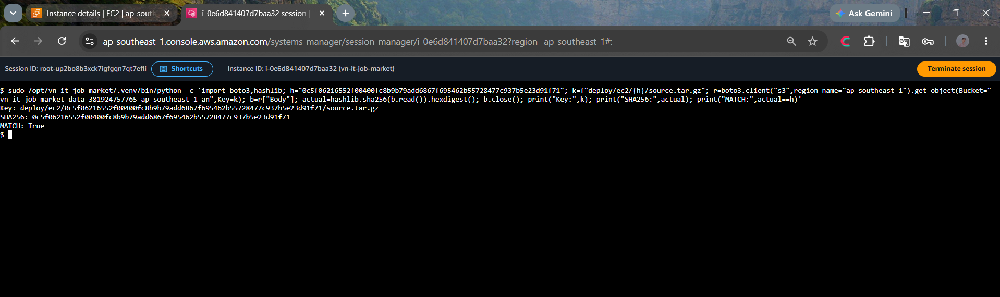

### Source layout on the server

The source code is located at **/opt/vn-it-job-market**. **collectors** contains ITviec collection programs, **processors** handles data processing, and **dashboard** provides the Streamlit application. **.venv** supplies Python and libraries for the services; its release-specific symbolic link selects the dependencies for the deployed version. The source is owned by root, while services run as vnjob, separating service operation from permission to modify program files.

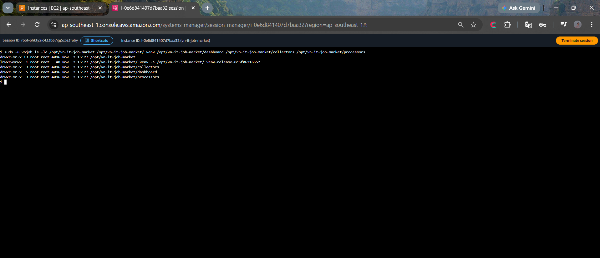

---

[← 4.6. Deploying source code and the runtime on EC2](../) · [Workshop contents](../../) · [Next step →](../5.6.2-step2/)
