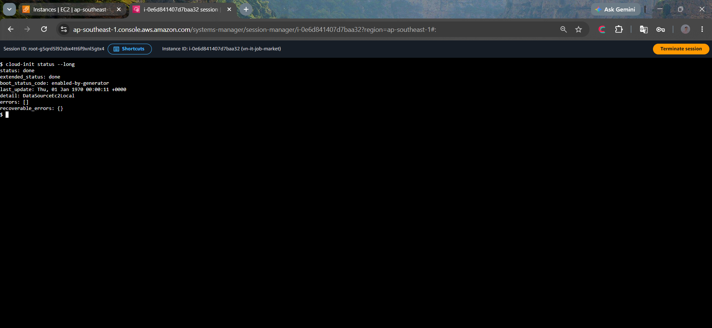
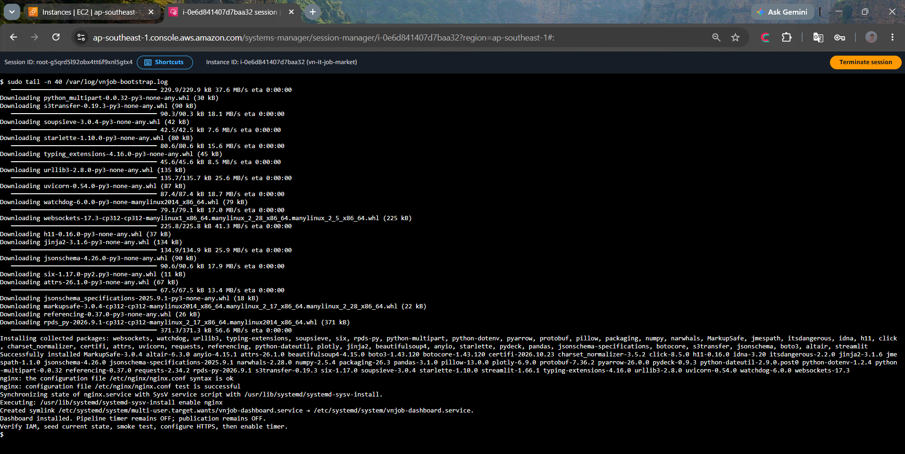
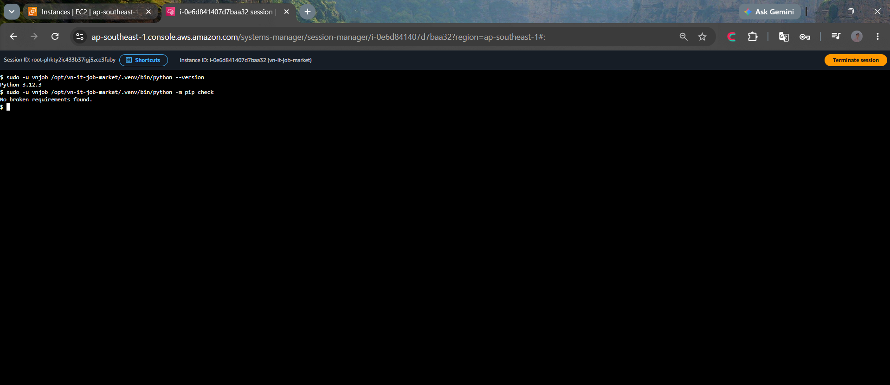
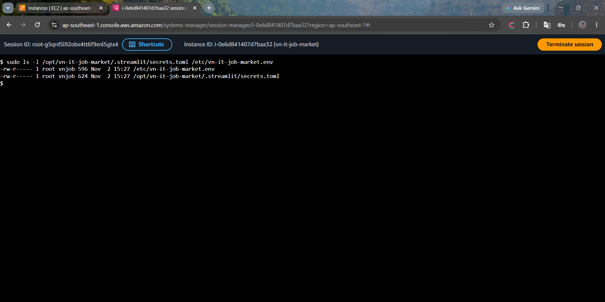

### Installing the EC2 environment

User Data downloads the source from S3 and runs the installation script to prepare the service account, Python environment, systemd units, and Nginx. The following screenshots show installation and configuration on the deployed server.

### Server initialization

**cloud-init** applies the EC2 initialization configuration from User Data, including application preparation and installation. Its status indicates whether initialization has finished and lists any recorded errors.

### Service environment installation

Bootstrap installs Python libraries, checks the Nginx configuration, and sets up the dashboard service. During initial installation, the pipeline timer and data publication remain disabled until data preparation and configuration are complete.

### Python environment validation

**.venv** supplies Python and shared dependencies for the dashboard, pipeline, and workers. **pip check** validates dependencies between installed packages to detect missing libraries or incompatible versions.

### Protecting configuration files

Both configuration files are owned by **root:vnjob** with permissions **640**: root can read and write, the vnjob group can read, and other accounts have no access. Services can therefore use the configuration without modifying it.

---

[← 4.6. Deploying source code and the runtime on EC2](../) · [Workshop contents](../../) · [Previous step](../5.6.1-step1/) · [Next step →](../5.6.3-step3/)
