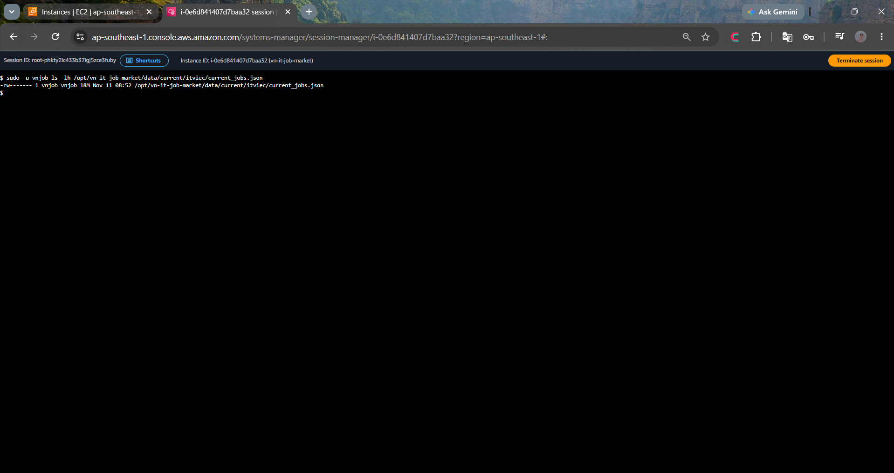
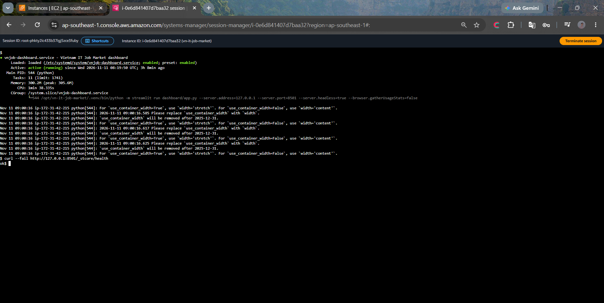

### Current data on EC2

**data/current/itviec/current_jobs.json** stores the current job dataset for subsequent synchronization, tracking timestamps, and analytics generation. The file is owned by **vnjob**, allowing the pipeline to read and update it using the service account.

### Dashboard service

**systemd** manages the dashboard as a service so it continues running after the SSM session closes and starts with the server. Streamlit listens on **127.0.0.1:8501**; Nginx forwards web requests to this internal port.

The **/_stcore/health** check confirms that Streamlit responds on its internal port before requests are routed through Nginx.

---

[← 4.6. Deploying source code and the runtime on EC2](../) · [Workshop contents](../../) · [Previous step](../5.6.2-step2/)
