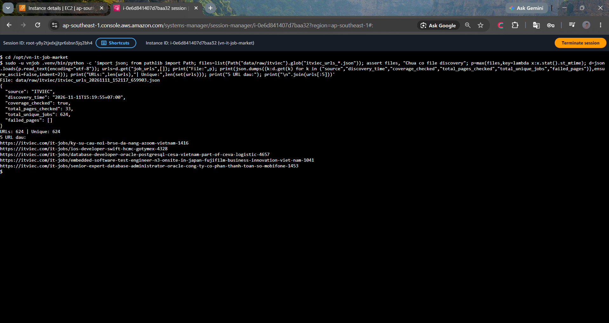

**Run in:** SSM on EC2

### Objectives

Start the collector through the orchestration service.

### Prerequisites

EC2, the seed data and the environment configuration in Section 4.6 are ready; no other run is in progress.

### Procedure

1. Check for running processes before starting:

~~~bash
sudo systemctl status vnjob-pipeline.service --no-pager
~~~

2. During setup, keep PIPELINE_PUBLISH=false to check the pipeline before publication. Save the environment configuration, then start the service:

~~~bash
sudo systemctl start --no-block vnjob-pipeline.service
sudo journalctl -u vnjob-pipeline.service -n 80 --no-pager -o cat
~~~

start --no-block returns control to the terminal while the runner continues in the background. Do not start another run while a process is active. The service loads /etc/vn-it-job-market.env and runs run_pipeline.py. The runner invokes discovery and selects a new file or reuses a valid file from the same Vietnam calendar day, up to six hours old.

Discovery reads JSON-LD ItemList data, normalizes HTTPS URLs under itviec.com/it-jobs and removes duplicates. The source defaults to a maximum of 500 pages, a two-second delay and a 20-second request timeout. To run the collector separately when no runner is active, use sudo -u vnjob .venv/bin/python collectors/discover_itviec_jobs.py. This workshop uses the service so that the entire run is validated.

### URL Discovery Results

The journal log dated 11 November 2026 records discovery_time as 15:19:55+07:00. Discovery stopped at page 33 because no more listings were found, with 624 unique URLs and no failed pages. File: **itviec_urls_20261111_152117_659903.json**.

~~~bash
sudo journalctl -u vnjob-pipeline.service --since "2026-11-11 08:15:00 UTC" --until "2026-11-11 08:25:00 UTC" --no-pager -o cat
~~~

View the discovery log recorded on 11 November 2026

<pre>DISCOVER ALL ITVIEC JOB URLS
======================================================================
Discovery time: 2026-11-11T15:19:55+07:00
Max page: 500
[1/500] Page 1
Job tren page: 20
Job moi unique: 20
Tong unique hien tai: 20
[2/500] Page 2
Job tren page: 20
Job moi unique: 20
Tong unique hien tai: 40
[3/500] Page 3
Job tren page: 20
Job moi unique: 20
Tong unique hien tai: 60
[4/500] Page 4
Job tren page: 20
Job moi unique: 20
Tong unique hien tai: 80
[5/500] Page 5
Job tren page: 20
Job moi unique: 20
Tong unique hien tai: 100
[6/500] Page 6
Job tren page: 20
Job moi unique: 20
Tong unique hien tai: 120
[7/500] Page 7
Job tren page: 20
Job moi unique: 20
Tong unique hien tai: 140
[8/500] Page 8
Job tren page: 20
Job moi unique: 20
Tong unique hien tai: 160
[9/500] Page 9
Job tren page: 20
Job moi unique: 20
Tong unique hien tai: 180
[10/500] Page 10
Job tren page: 20
Job moi unique: 20
Tong unique hien tai: 200
[11/500] Page 11
Job tren page: 20
Job moi unique: 20
Tong unique hien tai: 220
[12/500] Page 12
Job tren page: 20
Job moi unique: 20
Tong unique hien tai: 240
[13/500] Page 13
Job tren page: 20
Job moi unique: 20
Tong unique hien tai: 260
[14/500] Page 14
Job tren page: 20
Job moi unique: 20
Tong unique hien tai: 280
[15/500] Page 15
Job tren page: 20
Job moi unique: 20
Tong unique hien tai: 300
[16/500] Page 16
Job tren page: 20
Job moi unique: 20
Tong unique hien tai: 320
[17/500] Page 17
Job tren page: 20
Job moi unique: 20
Tong unique hien tai: 340
[18/500] Page 18
Job tren page: 20
Job moi unique: 20
Tong unique hien tai: 360
[19/500] Page 19
Job tren page: 20
Job moi unique: 20
Tong unique hien tai: 380
[20/500] Page 20
Job tren page: 20
Job moi unique: 20
Tong unique hien tai: 400
[21/500] Page 21
Job tren page: 20
Job moi unique: 20
Tong unique hien tai: 420
[22/500] Page 22
Job tren page: 20
Job moi unique: 20
Tong unique hien tai: 440
[23/500] Page 23
Job tren page: 20
Job moi unique: 19
Tong unique hien tai: 459
[24/500] Page 24
Job tren page: 20
Job moi unique: 20
Tong unique hien tai: 479
[25/500] Page 25
Job tren page: 20
Job moi unique: 20
Tong unique hien tai: 499
[26/500] Page 26
Job tren page: 20
Job moi unique: 20
Tong unique hien tai: 519
[27/500] Page 27
Job tren page: 20
Job moi unique: 20
Tong unique hien tai: 539
[28/500] Page 28
Job tren page: 20
Job moi unique: 20
Tong unique hien tai: 559
[29/500] Page 29
Job tren page: 20
Job moi unique: 20
Tong unique hien tai: 579
[30/500] Page 30
Job tren page: 20
Job moi unique: 20
Tong unique hien tai: 599
[31/500] Page 31
Job tren page: 20
Job moi unique: 20
Tong unique hien tai: 619
[32/500] Page 32
Job tren page: 5
Job moi unique: 5
Tong unique hien tai: 624
[33/500] Page 33
Job tren page: 0
Job moi unique: 0
Tong unique hien tai: 624
Page khong co job. Dung discovery.
======================================================================
KET QUA DISCOVERY
======================================================================
So page thanh cong: 33
So page that bai: 0
Tong job URL unique: 624
File: data/raw/itviec/itviec_urls_20261111_152117_659903.json</pre>

After the run, inspect the JSON file:

~~~bash
cd /opt/vn-it-job-market
sudo -u vnjob .venv/bin/python -c 'import json; from pathlib import Path; files=list(Path("data/raw/itviec").glob("itviec_urls_*.json")); assert files, "Chua co file discovery"; p=max(files,key=lambda x:x.stat().st_mtime); d=json.loads(p.read_text(encoding="utf-8")); urls=d.get("job_urls",[]); print("File:",p); print(json.dumps({k:d.get(k) for k in ("source","discovery_time","coverage_checked","total_pages_checked","total_unique_jobs","failed_pages")},ensure_ascii=False,indent=2)); print("URLs:",len(urls),"| Unique:",len(set(urls))); print("5 URL dau:"); print("\n".join(urls[:5]))'
~~~

### Check the results

Discovery should have coverage_checked=true, an empty failed_pages list and unique URLs. The run on 11 November 2026 recorded 624 URLs; the count varies with the listings available at the time.

---

[← 4.7. Set Up and Run ITviec Collection](../) · [Workshop Contents](../../) · [Next Step →](../5.7.2-step2/)
