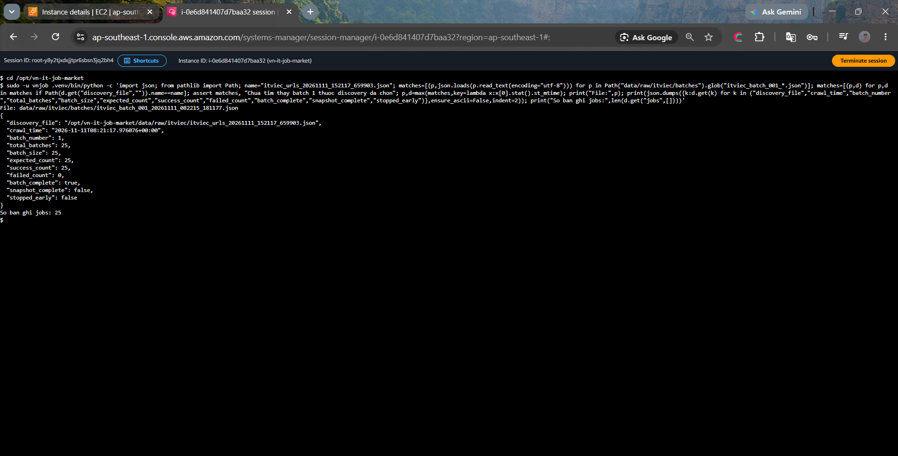

**Run in:** SSM on EC2

### Objectives

Collect job details and verify that each batch uses the correct input.

### Prerequisites

A valid discovery file is available and the pipeline has started.

### Procedure

The runner divides the URLs into batches of up to 25 jobs, passes PIPELINE_DISCOVERY_FILE and invokes itviec_batch_collector.py with the batch number. The 624 recorded URLs require 25 batches; the last batch contains fewer than 25 jobs.

The pipeline invokes the collector for each batch. Use the command below to inspect the output file created by the pipeline.

Inspect the first batch collected on 11 November 2026:

~~~bash
sudo -u vnjob .venv/bin/python -c 'import json; from pathlib import Path; name="itviec_urls_20261111_152117_659903.json"; matches=[(p,json.loads(p.read_text(encoding="utf-8"))) for p in Path("data/raw/itviec/batches").glob("itviec_batch_001_*.json")]; matches=[(p,d) for p,d in matches if Path(d.get("discovery_file","")).name==name]; assert matches, "Chua tim thay batch 1 thuoc discovery da chon"; p,d=max(matches,key=lambda x:x[0].stat().st_mtime); print("File:",p); print(json.dumps({k:d.get(k) for k in ("discovery_file","crawl_time","batch_number","total_batches","batch_size","expected_count","success_count","failed_count","batch_complete","snapshot_complete","stopped_early")},ensure_ascii=False,indent=2)); print("So ban ghi jobs:",len(d.get("jobs",[])))'
~~~

The screenshot shows batch_number=1, total_batches=25, expected_count=success_count=25, failed_count=0, batch_complete=true, stopped_early=false and 25 job records. discovery_file matches the file in the previous step. snapshot_complete=false is consistent with an individual batch.

### Check the results

The batch matches its discovery file and the successful record count matches expected_count. Batch 1 alone does not establish that the entire run succeeded.

---

[← 4.7. Set Up and Run ITviec Collection](../) · [Workshop Contents](../../) · [Previous Step](../5.7.1-step1/) · [Next Step →](../5.7.3-step3/)
