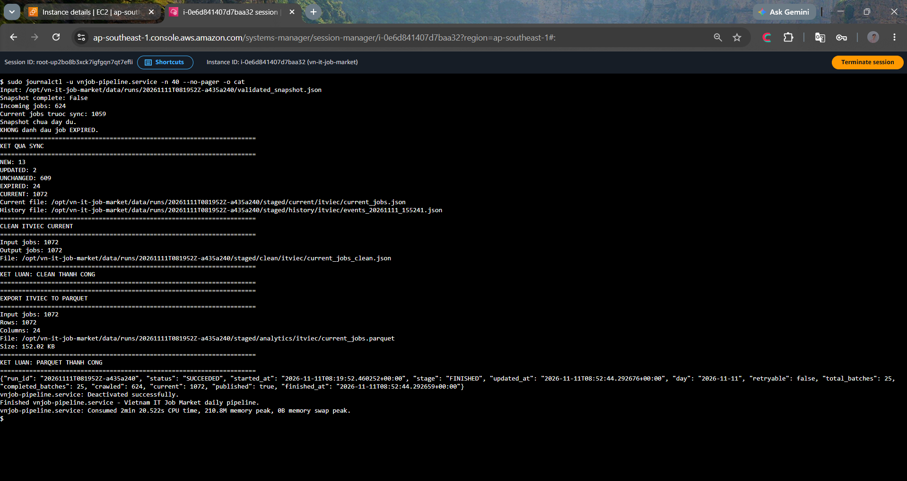

**Run in:** SSM on EC2

### Objectives

Pass only validated data to current-data synchronization.

### Prerequisites

The runner orchestrates all batches from one discovery file.

### Procedure

Monitor the journal and run status:

~~~bash
sudo journalctl -u vnjob-pipeline.service -n 120 --no-pager -o cat
sudo systemctl status vnjob-pipeline.service --no-pager
~~~

In data/runs/<RUN_ID_THUC_TE>/status.json, check stage, completed_batches, crawled, the final status and published. Read the file as vnjob or with the appropriate SSM permissions.

The runner validates the batch count, discovery_file, expected/success/failed counts, batch_complete and unique IDs across the complete dataset. It then writes validated_snapshot.json and runs sync, clean and export. Missing batches or errors prevent the input from passing ETL validation. Checkpoints keyed by the discovery SHA reuse URLs only within the limits implemented in the source.

Do not combine batches from different discovery files. For HTTP 403/429 responses, stop and assess source access conditions; do not retry continuously or lower coverage checks to force validation to pass.

### Check the results

The run has a run_id, valid aggregated input and an accurate final status. On failure, failed_stage and error_type identify the issue.

### Run Results on 11 November 2026

Run **20261111T081952Z-a435a240** completed **25/25 batches**, collected **624 jobs** and finished with **SUCCEEDED** and **published=true**. After synchronization, current data, clean data and Parquet contained **1,072 records**; the Parquet file had **24 columns**. The current dataset includes previously stored records and updates from this run.

---

[← 4.7. Set Up and Run ITviec Collection](../) · [Workshop Contents](../../) · [Previous Step](../5.7.2-step2/)
