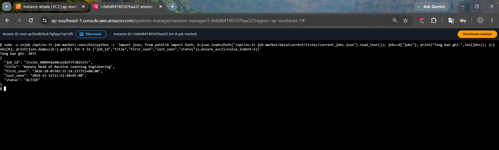
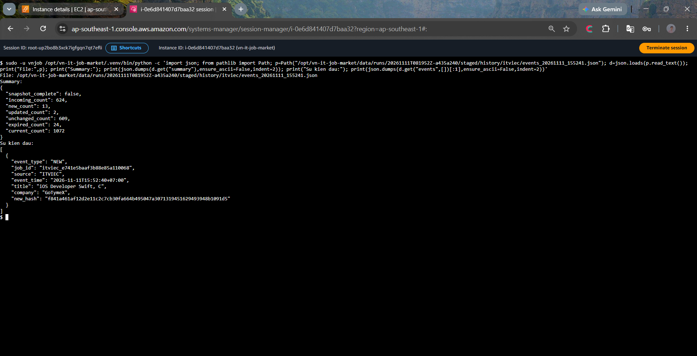

**Run in:** SSM on EC2

### Objectives

Synchronize the collected dataset and retain the job change history.

### Prerequisites

The run passed validation in Section 4.7.

### Procedure

At the SYNC_CURRENT stage, the runner prepares data/runs/<run_id>/staged/, seeds current data into staging, points the synchronization module to validated_snapshot.json and calls sync.main(). Do not invoke sync_itviec_current.py independently to synchronize the full run, because its default entry point may select the latest batch.

| Component | Processing |
| --- | --- |
| current | Upsert by job_id, preserve first_seen and update last_seen |
| history NEW/UPDATED | Record new jobs or changed fields |
| UNCHANGED | Count in the summary without creating a separate event |
| EXPIRED | A valid source deadline has passed; reason EXPLICIT_SOURCE_DEADLINE |

A job does not expire automatically because it is absent from discovery. ACTIVE/EXPIRED are record states, whereas history contains events; event counts therefore need not equal job counts.

Open staged/current/itviec/current_jobs.json and staged/history/itviec/events_*.json **within the same run directory** to trace job_id values and the summary.

### Track Jobs Across Synchronization Runs

**first_seen** preserves the time a job was first recorded, while **last_seen** stores its most recent observation. These fields track the same job across collection runs without losing its original observation time. **status** represents the job's state in the current dataset.

### Data Change History

The history file records new, updated and expired job events for each synchronization run. **summary** aggregates the processing results; each event includes the job ID, change type and event time. Unchanged jobs are counted in the summary without creating separate events.

### Check the results

Current data stores job information after synchronization; history stores events generated during the same processing run.

---

[← 4.8. Set Up ETL and Publish Parquet](../) · [Workshop Contents](../../) · [Next Step →](../5.8.2-step2/)
