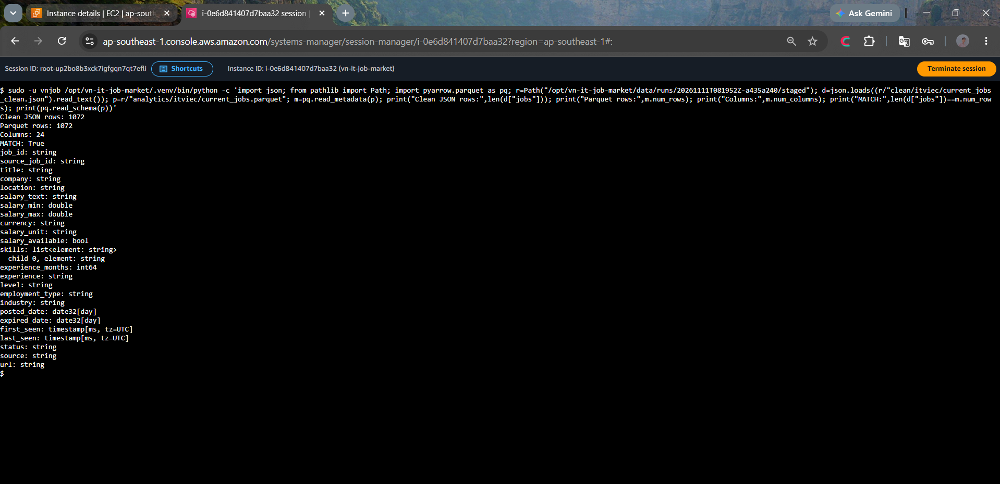

**Run in:** SSM on EC2

### Objectives

Normalize recruitment data and export a Parquet file for Athena queries.

### Prerequisites

Current staging data has been synchronized; PyArrow and the required dependencies are installed.

### Procedure

Within the pipeline, the runner points PIPELINE_DATA_ROOT to staged, then runs clean_itviec.py followed by export_itviec_parquet.py. The cleaner normalizes text, location, skills, experience, level and salary; the exporter uses PyArrow with Snappy compression.

The pipeline executes these steps sequentially on the synchronized data. Outputs remain in the run directory until publication to S3.

Skills processing removes empty and duplicate values while preserving order. Unrecognized locations are assigned Khác (Other), and missing experience is assigned Không xác định (Unspecified). Undisclosed salaries are not converted to zero or estimated. Check date/timestamp fields, the skills list and salary double fields against the DDL.

### Check the results

Clean JSON and Parquet have the same row count, and the schema is compatible with the Catalog. Current data may contain more records than the latest collection because it retains existing data.

### Validate the Parquet Export

Comparing clean JSON and Parquet row counts checks that export preserved the number of records. Schema inspection verifies that numeric, date, timestamp and skills-list fields use suitable types for Athena queries.

---

[← 4.8. Set Up ETL and Publish Parquet](../) · [Workshop Contents](../../) · [Previous Step](../5.8.1-step1/) · [Next Step →](../5.8.3-step3/)
