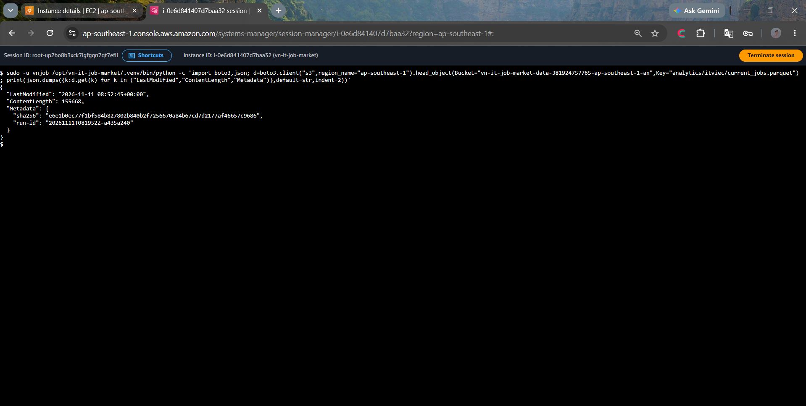

**Run in:** SSM on EC2

### Objectives

Publish validated data through the staging, journal and CAS mechanism.

### Prerequisites

The current seed is valid, the canonical S3 location contains exactly one Parquet file, and IAM and ETL checks are complete.

### Procedure

Open the environment file:

~~~bash
sudoedit /etc/vn-it-job-market.env
~~~

Set the following variables:

~~~ini
PIPELINE_BUCKET=vn-it-job-market-data-381924757765-ap-southeast-1-an
PIPELINE_PARQUET_KEY=analytics/itviec/current_jobs.parquet
PIPELINE_PUBLISH=true
~~~

Run the service after the previous run has finished:

~~~bash
sudo systemctl start --no-block vnjob-pipeline.service
sudo journalctl -u vnjob-pipeline.service -n 120 --no-pager -o cat
~~~

The runner processes or reuses discovery under the source conditions, validates the entire run, writes artifacts outside analytics, prepares the journal and backup, updates the canonical object using IfMatch with its ETag, and promotes local data. If the same Vietnam calendar day and mode already have a SUCCEEDED run, the runner records SKIPPED. Do not delete the marker to force a run.

Check the run's status.json and S3 metadata:

~~~bash
sudo -u vnjob .venv/bin/python -c 'import boto3,json; d=boto3.client("s3",region_name="ap-southeast-1").head_object(Bucket="vn-it-job-market-data-381924757765-ap-southeast-1-an",Key="analytics/itviec/current_jobs.parquet"); print(json.dumps({k:d.get(k) for k in ("ETag","LastModified","Metadata")},default=str,indent=2))'
~~~

SUCCEEDED and published=true must match the run-id and sha256 metadata. ETag is used for conditional writes and is not assumed to be SHA256. PIPELINE_PUBLISH=false may still process and commit local data; it is not a read-only mode.

### Check the results

The canonical object, artifacts and local state can be traced to the same run. On failure, retain the journal for recovery rather than forcing an overwrite.

### Trace Published Data

The **run-id** metadata links the Parquet file on S3 to the pipeline run that produced it. **sha256** stores the content checksum for integrity verification. The object's run-id in the screenshot matches the successful run recorded in Section 4.7.3.

---

[← 4.8. Set Up ETL and Publish Parquet](../) · [Workshop Contents](../../) · [Previous Step](../5.8.2-step2/)
