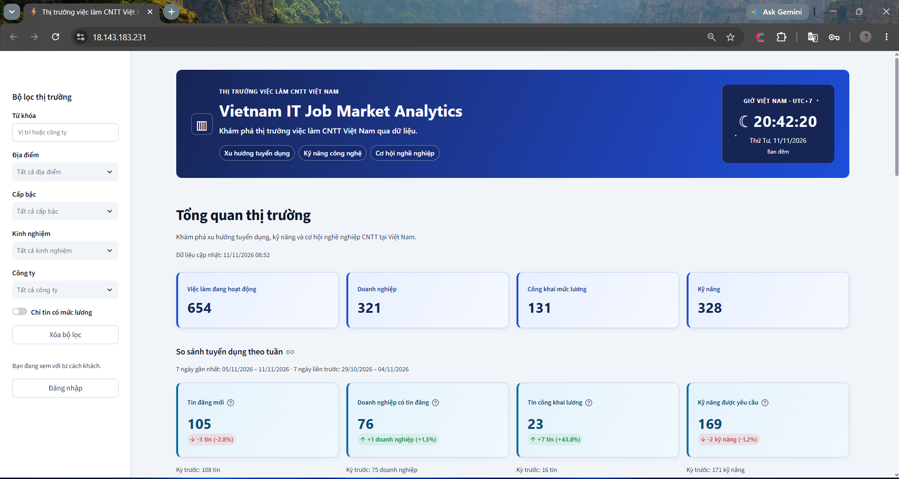
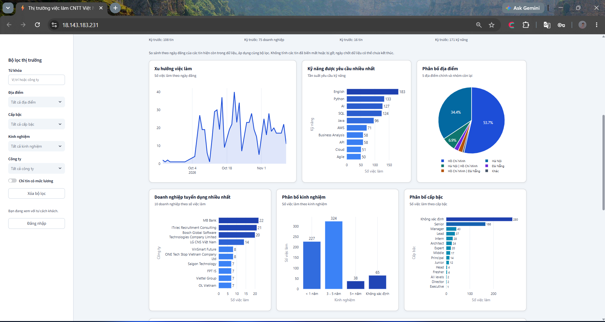
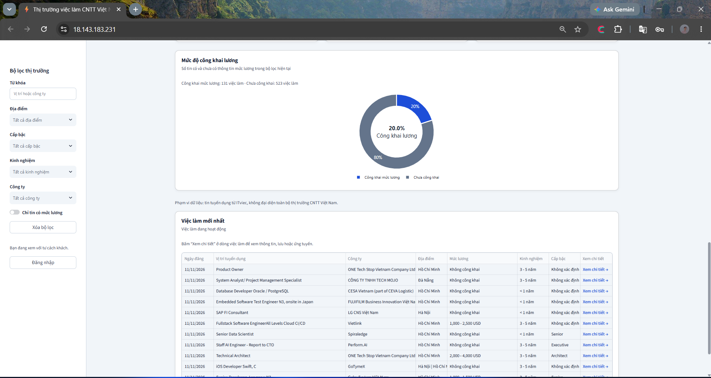

**Where:** Project website

### Objectives

Verify the existing analytics components.

### Prerequisites

The dashboard is connected to the correct dataset.

### Procedure

market_dashboard.py builds the interface, while weekly_metrics.py calculates weekly metrics. Open **Market overview**, clear the filters and check:

| Component | Content |
| --- | --- |
| Four overview KPIs | Active jobs, companies, jobs disclosing salary and skills |
| Four weekly KPIs | New postings, companies posting jobs, postings with salary information and skills in each cohort |
| Seven chart groups | Posting date, skills, locations, companies, experience, seniority and salary disclosure rate |

Weekly KPIs compare two seven-day periods based on posting dates, with the cutoff determined by the available data. When the previous period is zero, the dashboard shows a newly occurring value. A posting can contain multiple skills, so the total skill occurrences may exceed the number of postings.

Change the filters to check that the metrics, charts and job list update together for the selected scope.

### Check the results

All eight KPIs and the implemented charts are displayed consistently within the selected filters. These figures describe the collected dataset.

### Overview and weekly comparison

The overview KPIs summarize the displayed jobs, companies, salary-disclosing postings and skills. Weekly KPIs compare two seven-day periods by posting date to show changes in recruitment within the collected data. The filters on the left define the scope of analysis.

### Market analysis charts

The trend chart tracks jobs by posting date; skills and location charts show recruitment demand within the dataset. Company, experience and seniority charts help compare job opportunities across groups. All charts use the dashboard's selected filters.

### Salary disclosure

The chart separates postings with salary information from those without disclosed salaries under the current filters. This indicates the availability of salary information; undisclosed salaries are not treated as zero. The job list below allows users to move from aggregate statistics to individual postings.

---

[← 4.9. Configure and deploy the Streamlit Dashboard](../) · [Workshop contents](../../) · [Previous step](../5.9.1-step1/) · [Next step →](../5.9.3-step3/)
