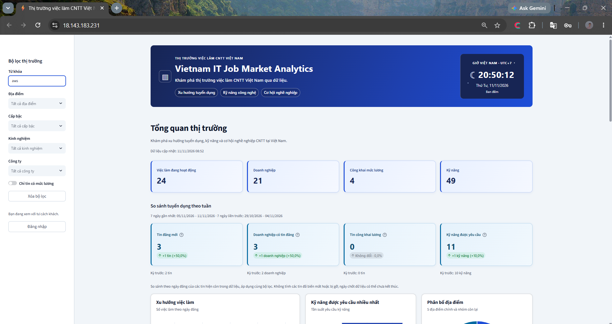
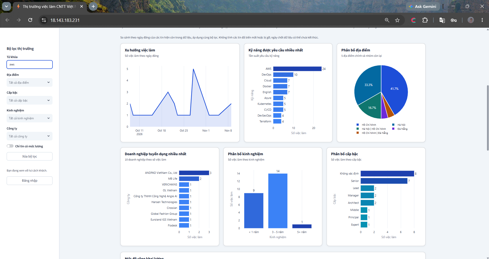
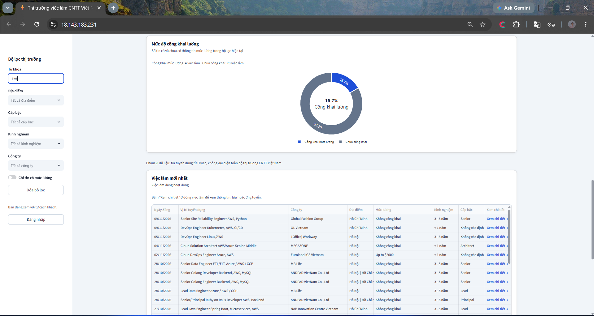
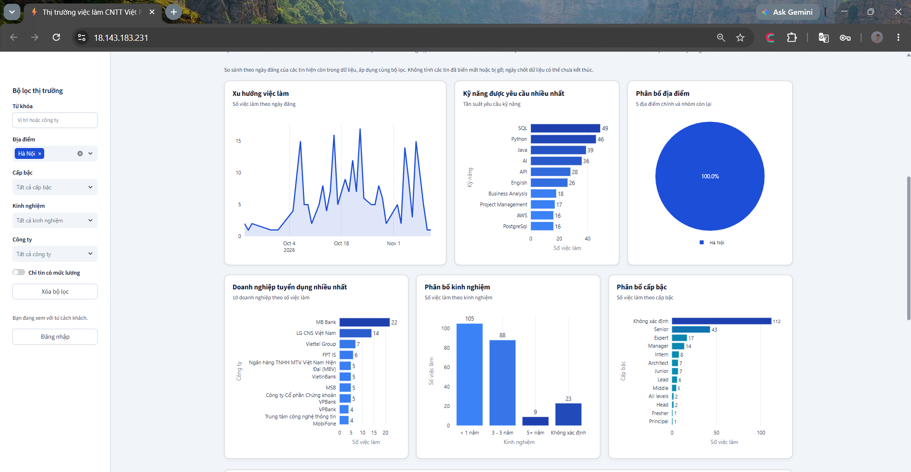
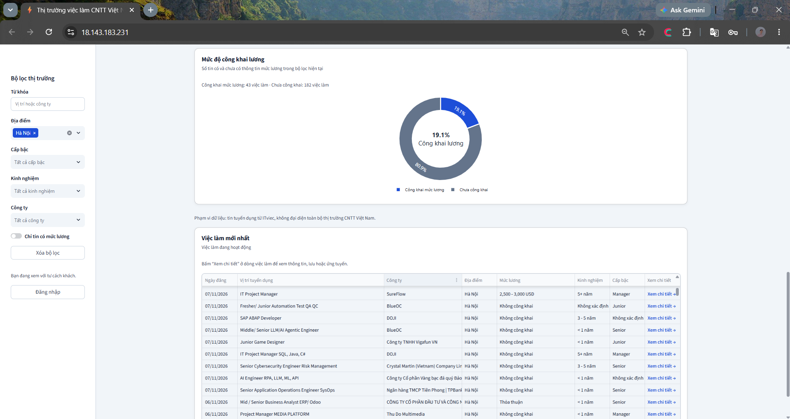
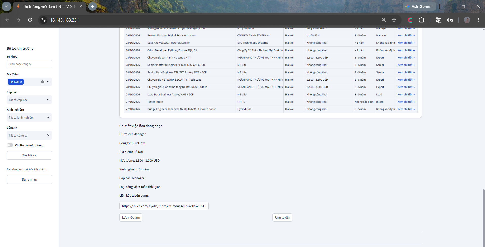

**Where:** Project website

### Objectives

Check the job search workflow after configuring the data sources.

### Prerequisites

The active job list has loaded.

### Procedure

1. Enter a job title or company keyword.
2. Select location, seniority, experience, company and salary availability filters.
3. Select View details on a row; check the title, company, job_id and ITviec URL.
4. Select another row to ensure the details change to the selected posting.
5. Try a keyword with no matches, then clear the filters to restore the list.

If the UI updates slowly after publication, check the data timestamp and cache before rerunning the pipeline. A successful health check confirms that the process responds; queries and application workflows require separate checks.

### Check the results

Search and filters return the appropriate data; job details and ITviec links match the selected posting. Empty results are handled without errors.

### Keyword search

The **Keyword** field searches job titles or companies to narrow the list to relevant postings. With **aws** entered, the KPIs, charts and job table update together to reflect the search results.

### Filter jobs by location

The location filter limits the dataset to the selected area. Selecting **Hà Nội** applies the same scope to KPIs, charts and the job list, allowing analysis and browsing of the same dataset.

### View job details

The details section helps users assess an opportunity through its company, location, salary, experience, seniority and employment type. The ITviec link opens the original posting. Save job and Apply connect to personal account features when the user is signed in.

---

[← 4.9. Configure and deploy the Streamlit Dashboard](../) · [Workshop contents](../../) · [Previous step](../5.9.2-step2/)
